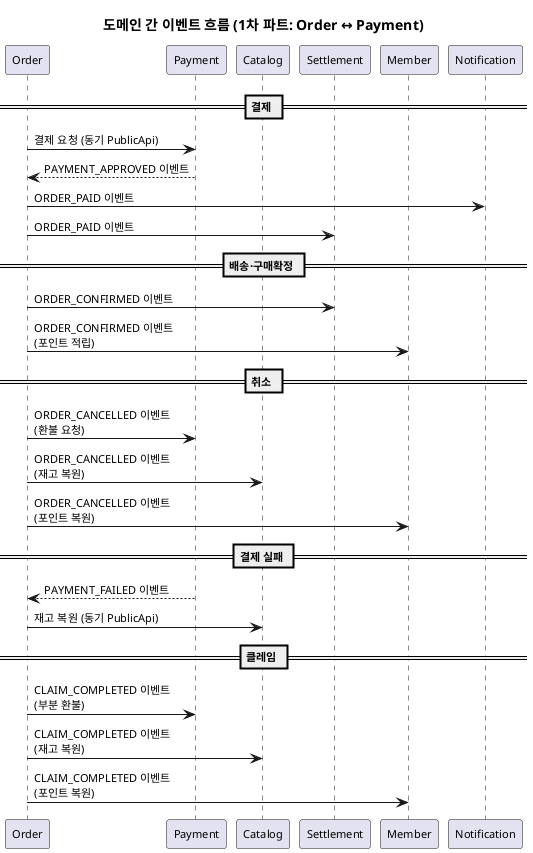

# 이벤트 플로우 — Order ↔ Payment

> **단계**: 구조설계
> **문서범위**: Domain 간
> **문서종류**: Design
>
> **작성 목적**: 도메인 간 비동기 이벤트 계약을 정의한다.
> **흐름 내 위치**: ⑪ 비즈니스 프로세스 → **⑫ 이벤트 플로우** → Bolt 분할
> **작성 주체**: 시니어 개발자 + AI 협업 (아키텍트 검토)

| 항목 | 내용 |
|---|---|
| ID | DESIGN-EVENT-001 |
| 상태 | **Finalized** |
| 작성일 | 2026-08-11 |
| 갱신일 | 2026-08-11 |

> **범위**: 1차 파트(Order + Payment) 간 이벤트. Catalog·Settlement·Member·Notification 연동은 해당 도메인 착수 시 보완.

---

## 이벤트 카탈로그

| 이벤트명 | 발행 도메인 | 수신 도메인 | 트리거 | 수신 액션 |
|---|---|---|---|---|
| PAYMENT_APPROVED | Payment | Order | PG 승인 성공 | 주문 상태 → PAYMENT_COMPLETED, 재고 선점 확정 |
| PAYMENT_FAILED | Payment | Order | PG 실패 (3회 재시도 소진) | 재고 복원, 주문 → PAYMENT_FAILED |
| ORDER_PAID | Order | Settlement*, Notification* | 결제완료 (PAYMENT_COMPLETED) | 정산 대기 등록, 주문확인 알림 |
| ORDER_CONFIRMED | Order | Settlement*, Member* | 구매확정 (CONFIRMED) | 정산 확정, 포인트 적립 |
| ORDER_CANCELLED | Order | Payment, Catalog*, Member* | 주문 취소 (CANCELLED) | PG 환불, 재고 복원, 포인트 복원 |
| CLAIM_COMPLETED | Order | Payment, Catalog*, Member* | 클레임 완료 | 부분 환불, 재고 복원, 포인트 복원 |

> `*` 표시: 2~4차 파트 착수 시 수신측 구현. 이벤트 발행은 1차에서 구현.

---

## 이벤트 흐름 다이어그램



---

## 이벤트 스키마

### PAYMENT_APPROVED

```json
{
  "eventType": "PAYMENT_APPROVED",
  "eventId": "evt-ulid-001",
  "timestamp": "2026-08-11T10:00:00Z",
  "payload": {
    "paymentId": "pay-ulid-001",
    "orderId": "ord-ulid-001",
    "platformOrderId": "pord-ulid-001",
    "amount": 35000,
    "paymentMethod": "CARD",
    "pgTransactionId": "toss-tx-12345",
    "approvedAt": "2026-08-11T10:00:00Z"
  }
}
```

### PAYMENT_FAILED

```json
{
  "eventType": "PAYMENT_FAILED",
  "eventId": "evt-ulid-002",
  "timestamp": "2026-08-11T10:00:30Z",
  "payload": {
    "paymentId": "pay-ulid-001",
    "orderId": "ord-ulid-001",
    "platformOrderId": "pord-ulid-001",
    "amount": 35000,
    "failReason": "CARD_DECLINED",
    "retryCount": 3
  }
}
```

### ORDER_CANCELLED

```json
{
  "eventType": "ORDER_CANCELLED",
  "eventId": "evt-ulid-003",
  "timestamp": "2026-08-11T11:00:00Z",
  "payload": {
    "orderId": "ord-ulid-001",
    "platformOrderId": "pord-ulid-001",
    "memberId": "mem-001",
    "vendorId": "vnd-001",
    "cancelReason": "CUSTOMER_REQUEST",
    "totalAmount": 35000,
    "items": [
      { "productId": "prod-001", "skuId": "sku-001", "quantity": 2 }
    ]
  }
}
```

### ORDER_CONFIRMED

```json
{
  "eventType": "ORDER_CONFIRMED",
  "eventId": "evt-ulid-004",
  "timestamp": "2026-08-18T00:00:00Z",
  "payload": {
    "orderId": "ord-ulid-001",
    "platformOrderId": "pord-ulid-001",
    "memberId": "mem-001",
    "vendorId": "vnd-001",
    "totalAmount": 35000,
    "confirmedAt": "2026-08-18T00:00:00Z",
    "items": [
      { "productId": "prod-001", "skuId": "sku-001", "quantity": 2, "amount": 35000 }
    ]
  }
}
```

### CLAIM_COMPLETED

```json
{
  "eventType": "CLAIM_COMPLETED",
  "eventId": "evt-ulid-005",
  "timestamp": "2026-08-20T15:00:00Z",
  "payload": {
    "claimId": "clm-ulid-001",
    "orderId": "ord-ulid-001",
    "claimType": "RETURN",
    "refundAmount": 17500,
    "items": [
      { "productId": "prod-001", "skuId": "sku-001", "quantity": 1 }
    ]
  }
}
```

---

## 동기 vs 비동기 판단

| 호출 | 방식 | 사유 |
|---|---|---|
| Order → Payment (결제 요청) | **동기** (PublicApi) | 즉시 결제 결과 필요 (UX 대기) |
| Order → Catalog (재고 선점) | **동기** (PublicApi) | 선점 실패 시 즉시 주문 거부 |
| Payment → Order (결제완료/실패) | **비동기** (이벤트) | PG 콜백 수신 후 후속 처리 |
| Order → Payment (환불) | **비동기** (이벤트) | 환불은 후속 처리, 즉시 응답 불필요 |
| Order → Settlement (정산) | **비동기** (이벤트) | 정산은 후속 처리 |
| Order → Notification (알림) | **비동기** (이벤트) | 알림은 후속 처리 |

---

## 이벤트 운영 규칙

| 규칙 | 설명 |
|---|---|
| Outbox 패턴 | 이벤트는 AFTER_COMMIT으로 Outbox 테이블에 기록 후 Consumer가 처리 |
| 멱등 보장 | 수신 측은 `eventId`로 중복 처리 방지 |
| 이벤트 스키마 버전 | 필드 추가는 허용, 삭제는 금지 (하위 호환) |
| 발행자는 수신자를 모름 | 이벤트 발행 시 수신 도메인을 하드코딩하지 않음 |
| 재시도 정책 | 수신 실패 시 최대 3회 재시도 (지수 백오프), 이후 DLQ |
| 순서 보장 | 동일 orderId에 대한 이벤트는 순서 보장 (파티션 키 = orderId) |

---

## 근거

| 항목 | 출처 |
|---|---|
| 이벤트 목록 | `11-비즈니스프로세스(Order).md`, `11-비즈니스프로세스(Payment).md` 이벤트 발행 지점 |
| 발행/수신 관계 | `05-도메인정의서.md` §4 도메인 간 관계 |
| Outbox 패턴 | `03-컴포넌트.md` 배포 구조·도메인 간 통신 방식 |
| 동기/비동기 판단 | 응답 즉시성 요구 여부 (UX 대기 vs 후속 처리) |
| 이벤트 스키마 | EARS(⑧) + 도메인 간 계약 합의 |
