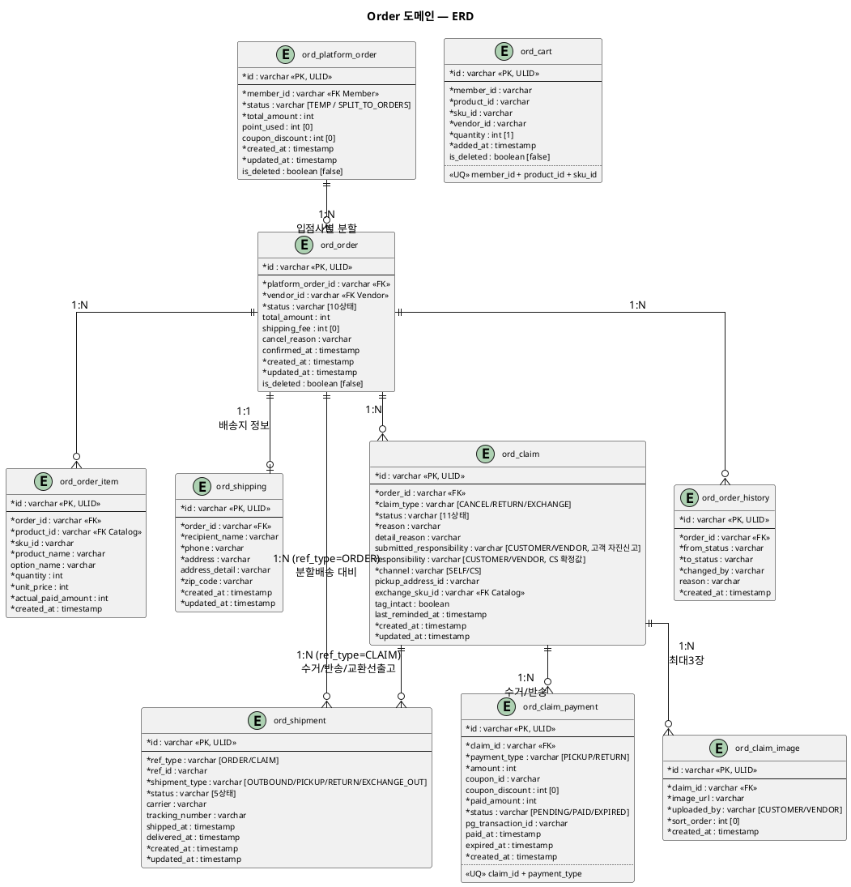

# 도메인 모델 (ERD) — Order

> **단계**: 구조설계
> **문서범위**: Domain
> **문서종류**: Design
>
> **작성 목적**: EARS(DE)에서 도출된 엔티티·속성·관계를 테이블 설계로 구체화한다.
> **흐름 내 위치**: DE EARS → **DF 도메인 모델(ERD)** → DG 상태머신
> **작성 주체**: 시니어 개발자 + AI 협업 (DBA/아키텍트 검토)

| 항목 | 내용 |
|---|---|
| ID | DESIGN-ERD-ORDER-001 |
| 상태 | **Finalized** |
| 작성일 | 2026-08-11 |
| 갱신일 | 2026-08-21 |

---

## ERD 다이어그램 (PlantUML)



---

## 2계층 주문 구조

```
ord_platform_order (고객 주문 단위, 1:N)
  └── ord_order (입점사별 처리 단위)
        ├── ord_order_item (주문상품 라인)
        ├── ord_shipping (배송지 정보, 1:1)
        ├── ord_shipment (배송 실행, 1:N — ref_type=ORDER, 분할배송 대비)
        ├── ord_claim (클레임)
        │     ├── ord_claim_payment (클레임 배송비 결제)
        │     ├── ord_claim_image (클레임 첨부 이미지)
        │     └── ord_shipment (배송 실행, 1:N — ref_type=CLAIM, 수거/반송/교환선출고)
        └── ord_order_history (상태변경 이력)

ord_cart (장바구니, 독립)
```

> **v6 (2026-08-20 신설)**: 배송 실행(택배사·운송장·집화/배송중/배송완료)을 `ord_order.status`·`ord_claim.status`에서 분리해 `ord_shipment`로 통합. 두 상태는 이제 "고객·판매자·CS가 판단·결정하는 지점"만 표현한다.

---

## DBML

```dbml
Table ord_platform_order {
  id varchar [pk, note: 'ULID']
  member_id varchar [not null, note: '주문자 (Member 도메인)']
  status varchar [not null, note: 'TEMP / SPLIT_TO_ORDERS']
  total_amount int [not null, note: '결제 요청 총액']
  point_used int [default: 0]
  coupon_discount int [default: 0]
  created_at timestamp [not null]
  updated_at timestamp [not null]
  is_deleted boolean [default: false]

  indexes {
    member_id [name: 'idx_porder_member']
    created_at [name: 'idx_porder_created']
  }

  note: '고객이 보는 주문 단위. 결제완료 즉시 입점사별 ord_order로 분할'
}

Table ord_order {
  id varchar [pk, note: 'ULID']
  platform_order_id varchar [not null, ref: > ord_platform_order.id]
  vendor_id varchar [not null, note: '입점사 ID (Vendor 도메인)']
  status varchar [not null, note: 'TEMP / ORDER_RECEIVED / PAYMENT_PENDING / PAYMENT_COMPLETED / PREPARING / DELIVERED / CONFIRMED / CANCELLED / PAYMENT_FAILED / STOCK_FAILED (10상태, v6: IN_DELIVERY 제거 — ord_shipment로 이관)']
  total_amount int [not null]
  shipping_fee int [default: 0]
  cancel_reason varchar
  confirmed_at timestamp
  created_at timestamp [not null]
  updated_at timestamp [not null]
  is_deleted boolean [default: false]

  indexes {
    platform_order_id [name: 'idx_order_platform']
    vendor_id [name: 'idx_order_vendor']
    (status, created_at) [name: 'idx_order_status_date']
  }

  note: '입점사별 처리 단위. 배송·정산·클레임의 기본 단위'
}

Table ord_order_item {
  id varchar [pk, note: 'ULID']
  order_id varchar [not null, ref: > ord_order.id]
  product_id varchar [not null, note: 'Catalog 상품 ID']
  sku_id varchar [not null, note: 'SKU (옵션 조합)']
  product_name varchar [not null, note: '주문 시점 스냅샷']
  option_name varchar
  quantity int [not null]
  unit_price int [not null, note: '주문 시점 단가']
  actual_paid_amount int [not null, note: '할인 안분 후 실결제금액']
  created_at timestamp [not null]

  indexes {
    order_id [name: 'idx_oitem_order']
  }
}

Table ord_cart {
  id varchar [pk, note: 'ULID']
  member_id varchar [not null]
  product_id varchar [not null]
  sku_id varchar [not null]
  vendor_id varchar [not null]
  quantity int [not null, default: 1]
  added_at timestamp [not null]
  is_deleted boolean [default: false]

  indexes {
    member_id [name: 'idx_cart_member']
    (member_id, product_id, sku_id) [unique, name: 'uq_cart_member_sku']
  }

  note: '장바구니. 동일 상품+옵션은 수량 합산 (REQ-ORD-005)'
}

Table ord_shipping {
  id varchar [pk, note: 'ULID']
  order_id varchar [not null, ref: > ord_order.id]
  recipient_name varchar [not null]
  phone varchar [not null, note: '마스킹: 010-****-5678']
  address varchar [not null]
  address_detail varchar
  zip_code varchar [not null]
  created_at timestamp [not null]
  updated_at timestamp [not null]

  indexes {
    order_id [name: 'idx_shipping_order']
  }

  note: '배송지 정보 전용 (v6: carrier/tracking_number/shipped_at/delivered_at은 ord_shipment로 이관)'
}

Table ord_shipment {
  id varchar [pk, note: 'ULID']
  ref_type varchar [not null, note: 'ORDER / CLAIM']
  ref_id varchar [not null, note: 'ord_order.id 또는 ord_claim.id']
  shipment_type varchar [not null, note: 'OUTBOUND(주문출고) / PICKUP(클레임수거) / RETURN(클레임반송) / EXCHANGE_OUT(교환선출고)']
  status varchar [not null, default: 'PENDING', note: 'PENDING / IN_TRANSIT / DELIVERED / FAILED / CANCELLED']
  carrier varchar
  tracking_number varchar
  shipped_at timestamp
  delivered_at timestamp
  created_at timestamp [not null]
  updated_at timestamp [not null]

  indexes {
    (ref_type, ref_id) [name: 'idx_shipment_ref']
    (ref_type, ref_id, shipment_type) [name: 'idx_shipment_ref_type']
    (status, created_at) [name: 'idx_shipment_status_date']
  }

  note: '배송 실행 전용 (v6 신설). 데이터모델은 order 1건에 N건 가능(분할배송 — (ref_type,ref_id,shipment_type) unique 아님)하도록 설계했으나, 1차 파트 S3(인터페이스명세·화면레이아웃)는 1주문:1배송만 구현 — 분할배송 API/UI는 Phase 2 범위(2026-08-21 바텀업 검토 확인). claim 1건이 PICKUP+EXCHANGE_OUT 동시 보유 가능(맞교환)은 현재 구현됨. order.status/claim.status의 배송완료 전이는 이 테이블의 DELIVERED 이벤트를 구독해 파생 갱신'
}

Table ord_claim {
  id varchar [pk, note: 'ULID']
  order_id varchar [not null, ref: > ord_order.id]
  claim_type varchar [not null, note: 'CANCEL / RETURN / EXCHANGE']
  status varchar [not null, note: 'RECEIVED / PAYMENT_PENDING / PAYMENT_EXPIRED / INSPECTING / PICKED_UP / PICKUP_REJECTED / REFUNDED / RETURN_PAYMENT_PENDING / DISPOSED / COMPLETED / REJECTED (11상태, v6: PICKUP/RETURN_SHIPPING/RETURN_DELIVERED 제거 — ord_shipment로 이관)']
  reason varchar [not null]
  detail_reason varchar [note: '상세 사유 (선택)']
  submitted_responsibility varchar [note: '고객이 신청 시 자진신고한 값(CUSTOMER/VENDOR). CS 판정 후에도 변경되지 않음 — REQ-ORD-076']
  responsibility varchar [note: 'CS 귀책판정 확정값. CUSTOMER(고객귀책) / VENDOR(판매자귀책, 상품불량 등 — 사진 최소 1장 필수). submitted_responsibility와 다를 수 있음(CS가 번복, REQ-ORD-066)']
  channel varchar [not null, default: 'SELF', note: '신청경로: SELF(고객직접) / CS(콜센터)']
  pickup_address_id varchar [note: '회수지 주소 ID (기본: 주문 배송지)']
  exchange_sku_id varchar [note: '교환 대상 SKU (Catalog 도메인, claim_type=EXCHANGE 전용, 선출고 시 사용)']
  tag_intact boolean [note: '품질점검 판정 근거 — 택(TAG) 부착 여부 (claim_type=EXCHANGE 전용)']
  last_reminded_at timestamp [note: 'RECEIVED 24시간 미처리 리마인드 최종 발송 시각 (REQ-ORD-068, 중복 발송 방지)']
  created_at timestamp [not null]
  updated_at timestamp [not null]

  indexes {
    order_id [name: 'idx_claim_order']
    (claim_type, status) [name: 'idx_claim_type_status']
    (status, created_at) [name: 'idx_claim_status_date']
  }

  note: '클레임. v3(2026-08-12) 14상태 확장 — 반송 배송비결제 대기/반송배송완료 포함. v4(2026-08-20): 교환(EXCHANGE) 맞교환 원칙 — exchange_sku_id/tag_intact 필드 추가. v6(2026-08-20): 배송실행 3상태(PICKUP/RETURN_SHIPPING/RETURN_DELIVERED) 제거해 11상태로 축소(ord_shipment로 이관), responsibility를 CUSTOMER/VENDOR 2종으로 단순화(PLATFORM 제거). v7(2026-08-21 바텀업 재검증): submitted_responsibility 필드 추가(CS 확정 후에도 고객 자진신고 이력 보존, REQ-ORD-076). RECEIVED/PAYMENT_PENDING 상태에서 고객 자진취소 시 REJECTED로 전환(사유="고객 자진 철회", REQ-ORD-073) — 신규 claim_type 없이 기존 REJECTED 재사용'
}

Table ord_claim_payment {
  id varchar [pk, note: 'ULID']
  claim_id varchar [not null, ref: > ord_claim.id]
  payment_type varchar [not null, note: 'PICKUP(수거배송비) / RETURN(반송배송비)']
  amount int [not null, note: '배송비 금액']
  coupon_id varchar [note: '배송비 쿠폰 적용 시']
  coupon_discount int [default: 0]
  paid_amount int [not null, note: '실결제금액 (amount - coupon_discount)']
  status varchar [not null, note: 'PENDING / PAID / EXPIRED']
  pg_transaction_id varchar [note: 'PG 거래번호']
  paid_at timestamp
  expired_at timestamp [note: '결제 만료 시각 (접수 후 24시간)']
  created_at timestamp [not null]

  indexes {
    claim_id [name: 'idx_cpay_claim']
    (claim_id, payment_type) [unique, name: 'uq_cpay_claim_type']
  }

  note: '클레임 배송비 결제. 수거/반송 구분 관리'
}

Table ord_claim_image {
  id varchar [pk, note: 'ULID']
  claim_id varchar [not null, ref: > ord_claim.id]
  image_url varchar [not null]
  uploaded_by varchar [not null, note: 'CUSTOMER(접수 시) / VENDOR(품질점검 판정 시) — REQ-ORD-075']
  sort_order int [not null, default: 0]
  created_at timestamp [not null]

  indexes {
    claim_id [name: 'idx_cimg_claim']
    (claim_id, uploaded_by) [name: 'idx_cimg_claim_uploader']
  }

  note: '클레임 첨부 이미지. uploaded_by별로 각각 최대 3장 독립 적용(REQ-ORD-075) — CUSTOMER(접수 시, VENDOR귀책 신청은 최소 1장 필수 REQ-ORD-058) / VENDOR(품질점검 거부 시, EXCHANGE 유형은 최소 1장 필수 REQ-ORD-072)'
}

Table ord_order_history {
  id varchar [pk, note: 'ULID']
  order_id varchar [not null, ref: > ord_order.id]
  from_status varchar [not null]
  to_status varchar [not null]
  changed_by varchar [not null, note: 'member_id / admin_id / SYSTEM']
  reason varchar
  created_at timestamp [not null]

  indexes {
    order_id [name: 'idx_history_order']
  }

  note: 'REQ-ORD-039: 모든 상태 변경 이력 기록'
}
```

---

## 불변식 (Invariants)

| 불변식 | 검증 시점 | 도출 근거 |
|---|---|---|
| `SUM(ord_order_item.actual_paid_amount) == ord_order.total_amount` | 주문 생성 시 | 부분반품 환불 기준 정합성 |
| `ord_cart` 동일 member+sku는 unique | 담기 시 | REQ-ORD-005: 수량 합산, 중복 라인 방지 |
| `ord_platform_order.total_amount == SUM(ord_order.total_amount) + SUM(ord_order.shipping_fee)` | 주문 분할 시 | 플랫폼주문↔입점사주문 금액 정합 |
| `ord_order.status` 전이는 상태머신(DG) 10상태 허용 전이만 가능 | 상태 변경 시 | 금지 전이 위반 방지 |
| `ord_claim.status` 전이는 상태머신(DG) 클레임 11상태 허용 전이만 가능 | 상태 변경 시 | 클레임 금지 전이 위반 방지 |
| `ord_claim_payment` 동일 claim+payment_type는 unique | 배송비 결제 시 | 수거/반송 배송비 중복 결제 방지 |
| `ord_claim_image` 동일 claim+uploaded_by는 각각 최대 3건 (접수분/판정분 독립) | 이미지 첨부 시 | REQ-ORD-075: 첨부 제한 3장은 업로더별 독립 적용 |
| `ord_claim_image` uploaded_by=CUSTOMER, submitted_responsibility=VENDOR 클레임은 최소 1건 이상 | 클레임 접수 확인 시 | REQ-ORD-058: 상품불량 등 판매자귀책 사유는 사진 증빙 필수 |
| `ord_claim_image` uploaded_by=VENDOR, claim_type=EXCHANGE 품질점검거부는 최소 1건 이상 | 품질점검 거부 판정 시 | REQ-ORD-072: 교환 판정도 사진 증빙 필수 |
| `ord_claim.submitted_responsibility`는 신청 후 불변, `responsibility`만 CS가 갱신 | 귀책 판정 확정 시 | REQ-ORD-076: 자진신고 이력 보존 |
| `ord_shipment.status` 전이는 상태머신(DG) 배송 5상태 허용 전이만 가능 | 상태 변경 시 | 배송 금지 전이 위반 방지 |

---

## Soft Delete 정책

| 테이블 | 정책 | 사유 |
|---|---|---|
| ord_cart | `is_deleted = true`, 30일 보관 후 배치 물리 삭제 | 비즈니스 데이터 아님 |
| ord_platform_order | `is_deleted = true`, 영구 보관 | 법적 보관 의무 (전자상거래법 5년) |
| ord_order | `is_deleted = true`, 영구 보관 | 법적 보관 의무 |
| ord_order_item | 물리 삭제 없음 | 주문 이력 일부 |
| ord_shipping | 물리 삭제 없음 | 배송지 증빙 |
| ord_shipment | 물리 삭제 없음 | 배송 실행 증빙 (v6 신설) |
| ord_claim | 물리 삭제 없음 | 클레임 이력 |
| ord_claim_payment | 물리 삭제 없음 | 배송비 결제 증빙 |
| ord_claim_image | 물리 삭제 없음 | 클레임 증빙 이미지 |
| ord_order_history | 물리 삭제 없음 | 감사 로그 |

---

## 근거

| 항목 | 출처 |
|---|---|
| 엔티티 도출 | `DE-EARS기능요구(Order).md` 주어/목적어 명사 추출 |
| 테이블 접두사 `ord_` | `DB-도메인정의서.md` 스키마 그룹핑 |
| 2계층 주문구조 | 도메인정의서 §4: Order-Vendor 관계 + 정산 단위 요구 |
| 장바구니 50개 제한 | REQ-ORD-004 |
| 스냅샷 원칙 (product_name, unit_price) | REQ-ORD-009 |
| 반품 기한 10일 | REQ-ORD-030 |
| 배송 실행 분리(ord_shipment) | 상태머신(DG) v6 — "고객·판매자·CS 의사결정 지점만 order/claim status로, 택배사 이동 구간은 별도" 원칙 |
| 판매자귀책 사진 필수 | REQ-ORD-058 |
