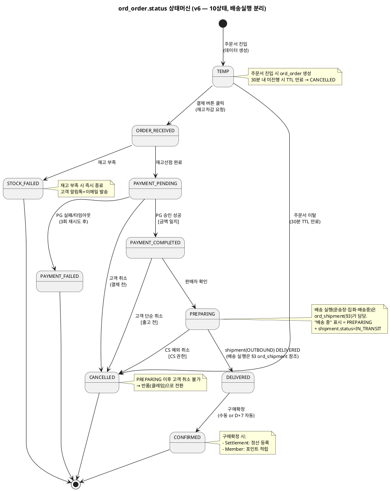
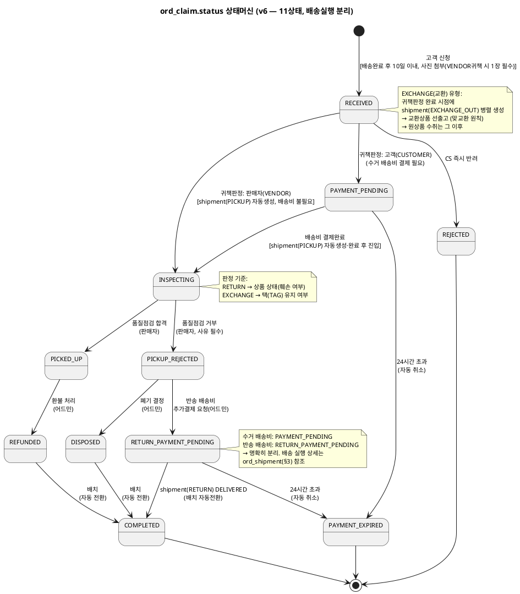
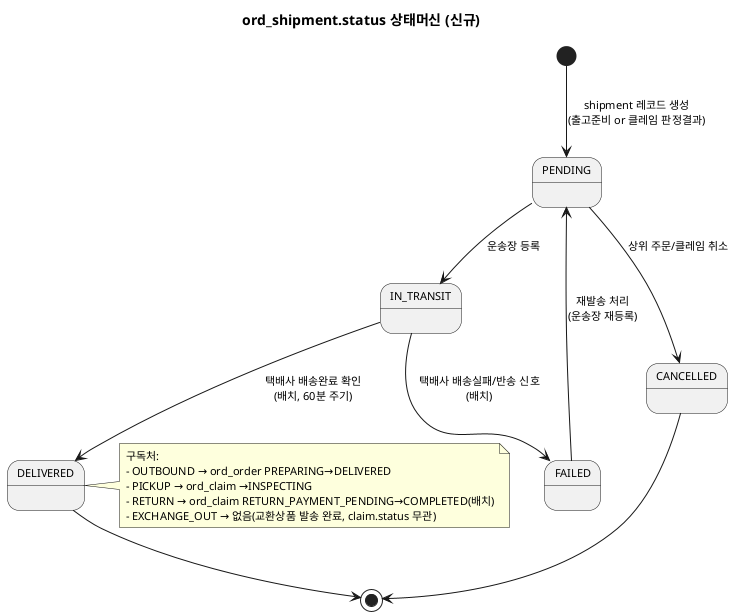

# 상태머신 — Order

> **단계**: 구조설계
> **문서범위**: Domain
> **문서종류**: Design
>
> **작성 목적**: ERD(DF)의 status 컬럼에서 허용 상태와 전이 규칙을 정의한다.
> **흐름 내 위치**: DF ERD → **DG 상태머신** → DH 비즈니스 프로세스 → DI 이벤트 플로우
> **작성 주체**: 시니어 개발자 + AI 협업 (기획자·현업 검토·확인)

| 항목 | 내용 |
|---|---|
| ID | DESIGN-SM-ORDER-001 |
| 상태 | **Finalized** |
| 작성일 | 2026-08-11 |
| 갱신일 | 2026-08-20 |

---

## 1. ord_order.status 상태머신

> **v6 (2026-08-20 현행화)**: 배송 실행(IN_DELIVERY)을 `ord_shipment`(§3)로 분리 — 11상태→10상태. order.status는 이제 "고객·판매자·CS가 판단·결정하는 지점"만 표현하며, "배송 중" 표시는 `PREPARING + shipment(OUTBOUND).status=IN_TRANSIT` 조인으로 화면에서 계산한다.

### 상태 목록

| 상태 | 설명 | 진입 조건 |
|---|---|---|
| TEMP | 임시주문 생성 (주문서 진입) | 주문서 화면 진입 시 데이터 생성 |
| ORDER_RECEIVED | 주문접수 (재고차감 요청 중) | 고객 결제 버튼 클릭 |
| PAYMENT_PENDING | 결제 요청 중 (재고선점 완료) | 재고 선점 성공 |
| PAYMENT_COMPLETED | 결제 완료 (PG 승인) | PG 승인 성공 |
| PREPARING | 출고 준비~배송 중 | 판매자 확인 (배송실행 상세는 ord_shipment 참조) |
| DELIVERED | 배송 완료 | shipment(OUTBOUND) DELIVERED (파생) |
| CONFIRMED | 구매 확정 | 고객 수동 or D+7 자동 |
| CANCELLED | 취소 | 고객 취소 or CS 예외 취소 |
| PAYMENT_FAILED | 결제 실패 | PG 실패/타임아웃 (3회 재시도 후) |
| STOCK_FAILED | 재고 부족 실패 | 재고 선점 실패 |

### 전이 다이어그램

### 전이 규칙 상세

| From | To | 트리거 | 가드 (조건) | 액션 (부수효과) | 액터 | 화면 기능 |
|---|---|---|---|---|---|---|
| [*] | TEMP | 주문서 진입 | — | ord_order 생성 | 고객 | 주문서 화면 진입 |
| TEMP | ORDER_RECEIVED | 고객 결제 버튼 클릭 | 주문서 유효성 검증 통과 | Catalog에 재고차감 요청 | 고객 | 주문서 [결제하기] 버튼 |
| TEMP | CANCELLED | 주문서 이탈 (TTL 30분) | — | 임시 데이터 정리 | 시스템(배치) | 없음 |
| ORDER_RECEIVED | PAYMENT_PENDING | 재고선점 성공 | Catalog 응답 success | PG 결제 요청 시작 | 시스템 | 없음 (Catalog 콜백) |
| ORDER_RECEIVED | STOCK_FAILED | 재고선점 실패 | Catalog 응답 StockInsufficient | 고객 알림톡+이메일 발송 | 시스템 | 없음 (Catalog 콜백) |
| PAYMENT_PENDING | PAYMENT_COMPLETED | PAYMENT_APPROVED 이벤트 | 금액 일치 검증 | 주문확인 알림톡+이메일 | 시스템 | 없음 (PG 콜백) |
| PAYMENT_PENDING | PAYMENT_FAILED | PAYMENT_FAILED 이벤트 | 3회 재시도 소진 | 재고 복원, 고객 알림 | 시스템 | 없음 |
| PAYMENT_PENDING | CANCELLED | 고객 취소 요청 | — | 재고 복원 | 고객 | 결제창 [취소] |
| PAYMENT_COMPLETED | PREPARING | 판매자 확인 | — | — | 판매자 | 주문상세 [출고 처리] 버튼 |
| PAYMENT_COMPLETED | CANCELLED | 고객 취소 요청 | 출고 전 상태 | PG 환불 요청, 재고 복원 | 고객 | 주문상세 [주문취소] 버튼 |
| PREPARING | CANCELLED | CS 예외 취소 요청 | CS 담당자 권한 | PG 환불 요청, 재고 복원 (REQ-ORD-017) | CS 담당자 | 주문상세 CS탭 [예외취소] 버튼 |
| **PREPARING** | **DELIVERED** | **shipment(OUTBOUND) DELIVERED** | shipment 상태 전이 구독 | D+7 자동확정 타이머 시작, 고객 알림톡 | 시스템 | 없음 (§3 이벤트 구독, 파생 전환) |
| DELIVERED | CONFIRMED | 고객 수동 or D+7 배치 | — | 정산 등록 이벤트, 포인트 적립 이벤트 | 고객/시스템(배치) | 주문상세 [구매확정] 버튼 / D+7 배치 |

### 금지 전이

| From | To | 사유 | EARS 근거 |
|---|---|---|---|
| CONFIRMED | CANCELLED | 구매확정 후 취소 불가 (클레임으로 전환) | REQ-ORD-019 |
| PREPARING 이후(DELIVERED 등) | CANCELLED | 배송 시작 후 **고객** 취소 불가 (반품 신청 안내). CS 예외취소도 PREPARING까지만 허용 | REQ-ORD-019 |
| PAYMENT_FAILED | 모든 상태 | 종료 상태 (재주문 필요) | — |
| STOCK_FAILED | 모든 상태 | 종료 상태 (재주문 필요) | — |
| CANCELLED | 모든 상태 | 종료 상태 | — |

---

## 2. ord_claim.status 상태머신

> **v3 (2026-08-12 현행화)**: 반송 배송비결제 대기/반송배송완료 상태 추가 (12상태 → 14상태).
> **v4 (2026-08-20 현행화)**: 교환(EXCHANGE)은 "맞교환" 원칙 — PICKUP 진입 시 교환상품을 선출고(선출고 후 수취)하며, INSPECTING 판정 기준은 택(TAG) 유지 여부로 한다(REQ-ORD-056/057 참고).
> **v6 (2026-08-20 현행화)**: 배송 실행 3상태(PICKUP/RETURN_SHIPPING/RETURN_DELIVERED)를 `ord_shipment`(§3)로 분리 — 14상태→11상태. claim.status는 "고객·판매자·CS가 판단·결정하는 지점"만 표현한다(INSPECTING은 판매자의 실제 판정 행위라 유지). responsibility는 CUSTOMER/VENDOR 2종으로 단순화(PLATFORM 제거). 반품 접수 시 VENDOR 귀책 사유는 사진 최소 1장 필수(REQ-ORD-058).

### 상태 목록

| 상태 | 설명 | 진입 조건 | 수행 주체 |
|---|---|---|---|
| RECEIVED | 접수됨 | 고객 반품/교환 신청 | 고객 |
| PAYMENT_PENDING | 수거 배송비 결제 대기~수거 진행 중 | 고객(CUSTOMER) 귀책 확정 시 | 고객 |
| PAYMENT_EXPIRED | 결제 만료 (자동 취소) | 24시간 초과 | 배치 |
| INSPECTING | 품질점검 진행 중 | 판매자(VENDOR) 귀책 즉시 또는 수거 shipment 입고 확인 | 판매자 |
| PICKED_UP | 수거완료 (품질점검 합격) | 합격 판정 | 판매자 |
| PICKUP_REJECTED | 수거거부 (품질점검 불합격) | 불합격 판정 + 사유 등록 | 판매자 |
| REFUNDED | 환불 완료 | 어드민 환불 처리 | 어드민 |
| RETURN_PAYMENT_PENDING | 반송 배송비 결제 대기~반송 진행 중 | 어드민 반송결제 요청 | 고객 |
| DISPOSED | 폐기 처리 | 어드민 폐기 결정 | 어드민 |
| COMPLETED | 클레임 전체 완료 | 환불완료 or 반송배송완료(shipment) or 폐기 후 자동 | 배치 |
| REJECTED | 접수 단계 반려 | CS 반려 확정 | 어드민 |

### 전이 다이어그램

### 전이 규칙 상세

| From | To | 트리거 | 가드 (조건) | 액션 (부수효과) | 액터 | 화면 기능 |
|---|---|---|---|---|---|---|
| [*] | RECEIVED | 반품/교환 신청 | VENDOR 귀책 사유 선택 시 사진 1장 이상(REQ-ORD-058) | — | 고객 | 신청 폼 제출 |
| RECEIVED | PAYMENT_PENDING | 귀책 판정(CUSTOMER) | 고객 귀책 사유 확인 | 수거 배송비 결제 알림톡 발송 | CS 담당자 | 클레임상세 [귀책판정: 고객귀책] |
| RECEIVED | INSPECTING | 귀책 판정(VENDOR) + shipment(PICKUP) 완료 | 판매자 귀책 사유 확인 | 수거 즉시 시작, shipment(PICKUP)/EXCHANGE시 shipment(EXCHANGE_OUT) 생성(REQ-ORD-056) | CS 담당자 + 판매자 | [귀책판정: 판매자귀책] → 판매자 [수거정보입력] → [입고확인] |
| RECEIVED | REJECTED | CS 즉시 반려 | 사유 필수 | 고객 알림톡 | CS 담당자 | [반려] + 사유입력 |
| PAYMENT_PENDING | INSPECTING | 배송비 결제 + shipment(PICKUP) 완료 | PG 결제 성공 | 수거 시작, EXCHANGE시 shipment(EXCHANGE_OUT) 생성(REQ-ORD-056) | 고객 + 판매자 | [배송비 결제하기] → 판매자 [수거정보입력] → [입고확인] |
| PAYMENT_PENDING | PAYMENT_EXPIRED | 24시간 초과 | 미결제 | 클레임 자동 취소, 알림톡 | 시스템(배치) | 없음 |
| INSPECTING | PICKED_UP | 품질점검 합격 | 상품 상태 양호(RETURN) / 택(TAG) 유지(EXCHANGE, REQ-ORD-057) | — | 판매자 | 클레임상세 [합격] 버튼 |
| INSPECTING | PICKUP_REJECTED | 품질점검 거부 | 사유 필수. 상품 훼손(RETURN) / 택 제거·훼손(EXCHANGE, REQ-ORD-057) | 어드민 판정 대기 | 판매자 | 클레임상세 [거부] 버튼 |
| PICKED_UP | REFUNDED | 환불 처리 | — | PG 환불 또는 계좌이체 | CS 담당자 | [환불 처리] 버튼 |
| PICKUP_REJECTED | DISPOSED | 폐기 결정 | 반송 불가 판단 | 고객 알림톡 | CS 담당자 | [폐기 처리] 버튼 |
| PICKUP_REJECTED | RETURN_PAYMENT_PENDING | 반송 배송비 요청 | — | 고객에게 결제 알림톡 | CS 담당자 | [반송 배송비 추가결제 요청] 버튼 |
| RETURN_PAYMENT_PENDING | COMPLETED | 결제 + shipment(RETURN) DELIVERED | PG 결제 성공 | 반송 배송 완료 후 클레임 완료 알림톡 | 고객 + 판매자 + 시스템(배치) | [반송 배송비 결제] → 판매자 [반송운송장등록] → 배치 자동전환 |
| RETURN_PAYMENT_PENDING | PAYMENT_EXPIRED | 24시간 초과 | 미결제 | 클레임 자동 취소, 알림톡 | 시스템(배치) | 없음 |
| REFUNDED | COMPLETED | 배치 자동 전환 | — | 클레임 완료 알림톡 | 시스템(배치) | 없음 |
| DISPOSED | COMPLETED | 배치 자동 전환 | — | — | 시스템(배치) | 없음 |

### 금지 전이

| From | To | 사유 |
|---|---|---|
| COMPLETED | 모든 상태 | 종료 상태 (신규 클레임 생성 필요) |
| REJECTED | 모든 상태 | 종료 상태 |
| PAYMENT_EXPIRED | 모든 상태 | 종료 상태 (재신청 필요) |
| PICKED_UP | PICKUP_REJECTED | 합격 확정 후 거부 불가 |
| PICKUP_REJECTED | PICKED_UP | 거부 확정 후 합격 불가 |

---

## 3. ord_shipment.status 상태머신 (신규 v6 — 배송 실행 전용, order/claim 공용)

> 배송 실행(택배사가 실제로 물건을 이동시키는 구간)을 order.status·claim.status에서 분리한 신규 엔티티. `shipment_type`: OUTBOUND(주문출고)/PICKUP(클레임수거)/RETURN(클레임반송)/EXCHANGE_OUT(교환선출고).

### 상태 목록

| 상태 | 설명 | 진입 조건 |
|---|---|---|
| PENDING | 운송장 미등록 | shipment 레코드 생성 |
| IN_TRANSIT | 운송장 등록, 이동 중 | 운송장 등록 |
| DELIVERED | 배송완료 | 택배사 배송완료 확인 (배치) |
| FAILED | 배송실패/반송 | 택배사 배송실패 신호 (배치) |
| CANCELLED | 상위 주문/클레임 취소로 배송 취소 | 상위 취소 이벤트 |

### 전이 다이어그램

### 전이 규칙 상세

| From | To | 트리거 | 액터 | 화면 기능 |
|---|---|---|---|---|
| [*] | PENDING | shipment 생성 | 시스템 | 없음 (주문 PREPARING 진입 / 클레임 귀책판정·반송결제완료 시 자동 생성) |
| PENDING | IN_TRANSIT | 운송장 등록 | 판매자 | 배송관리 [운송장 등록] / 클레임상세 [수거정보입력]·[반송운송장등록]·[교환선출고 운송장등록] |
| PENDING | CANCELLED | 상위 주문/클레임 취소 | 시스템 | 없음 (주문취소·클레임반려 이벤트 구독) |
| IN_TRANSIT | DELIVERED | 택배사 배송완료 확인 | 시스템(배치) | 없음 (REQ-ORD-060) |
| IN_TRANSIT | FAILED | 택배사 배송실패/반송 신호 | 시스템(배치) | 없음 (CS 알림 발송, REQ-ORD-061) |
| FAILED | PENDING | 재발송 처리 | 판매자/CS 담당자 | 배송관리 [재발송 처리] *(신규, REQ-ORD-062)* |

### 금지 전이

| From | To | 사유 |
|---|---|---|
| DELIVERED | 모든 상태 | 종료 상태 |
| CANCELLED | 모든 상태 | 종료 상태 |

---

## Bolt 분할 후보 (상태 전이 기반)

> 상태 전이 1개 = Bolt 1개 후보 (부록 A 기준 #3)

| Bolt 후보 | 상태 전이 | 예상 규모 |
|---|---|---|
| 장바구니 | — (독립 CRUD + 옵션변경) | 반나절 |
| 주문서 생성 (임시주문) | [*]→TEMP | 반나절 |
| 주문접수·재고선점 | TEMP→ORDER_RECEIVED→PAYMENT_PENDING | 1일 |
| 결제 완료 처리 | PAYMENT_PENDING→PAYMENT_COMPLETED | 반나절 |
| 결제 실패·재고 부족 처리 | PAYMENT_PENDING→PAYMENT_FAILED, ORDER_RECEIVED→STOCK_FAILED | 반나절 |
| 고객 취소 | PAYMENT_COMPLETED→CANCELLED | 반나절 |
| 출고 처리 | PAYMENT_COMPLETED→PREPARING (+ shipment(OUTBOUND) 생성) | 1일 |
| 배송 실행 (order/claim 공용, 신규) | shipment: PENDING→IN_TRANSIT→DELIVERED/FAILED | 1일 |
| 배송 완료 | PREPARING→DELIVERED (shipment 파생) | 반나절 |
| 구매 확정 | DELIVERED→CONFIRMED | 반나절 |
| 반품/교환 신청 | [*]→RECEIVED | 반나절 |
| 클레임 귀책판정·배송비 결제 | RECEIVED→PAYMENT_PENDING / RECEIVED→INSPECTING(판매자귀책) | 반나절 |
| 품질점검 (판매자) | INSPECTING→PICKED_UP/PICKUP_REJECTED | 1일 |
| 환불 처리 (어드민) | PICKED_UP→REFUNDED→COMPLETED | 반나절 |
| 폐기·반송 판정 (어드민) | PICKUP_REJECTED→DISPOSED→COMPLETED, PICKUP_REJECTED→RETURN_PAYMENT_PENDING→COMPLETED(+ shipment(RETURN)) | 1일 |

---

## 근거

| 항목 | 출처 |
|---|---|
| 상태 목록 | `DF-도메인모델ERD(Order).md` ord_order.status, ord_claim.status, ord_shipment.status |
| 전이 규칙 | `DE-EARS기능요구(Order).md` Event-driven/Unwanted 패턴 |
| 금지 전이 | REQ-ORD-017, REQ-ORD-019 |
| D+7 자동확정 | REQ-ORD-015 |
| 반품 10일 기한 | REQ-ORD-030 |
| 교환(맞교환) 선출고·택유지 판정 | REQ-ORD-056, REQ-ORD-057 |
| 반품 접수 사진 필수(VENDOR귀책) | REQ-ORD-058 |
| 배송 실행 분리(ord_shipment) | REQ-ORD-059~062 |
| Bolt 분할 기준 | 방법론 부록 A (전이 1개 = Bolt 1개) |
