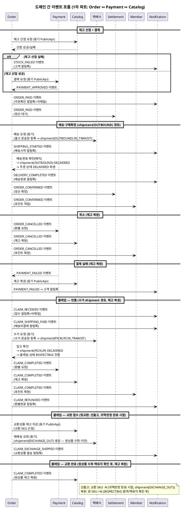

# 이벤트 플로우 — Order ↔ Payment

> **단계**: 구조설계
> **문서범위**: Domain 간
> **문서종류**: Design
>
> **작성 목적**: 도메인 간 비동기 이벤트 계약을 정의한다.
> **흐름 내 위치**: DH 비즈니스 프로세스 → **DI 이벤트 플로우** → Bolt 분할
> **작성 주체**: 시니어 개발자 + AI 협업 (아키텍트 검토)

| 항목 | 내용 |
|---|---|
| ID | DESIGN-EVENT-001 |
| 상태 | **Finalized** |
| 작성일 | 2026-08-11 |
| 갱신일 | 2026-08-20 |

> **범위**: 1차 파트(Order + Payment) 간 이벤트. Catalog·Settlement·Member·Notification 연동은 해당 도메인 착수 시 보완.
> **v2 (2026-08-20 현행화)**: 교환(EXCHANGE) 맞교환 원칙 반영 — 재배송·교환 SKU 차감을 CLAIM_COMPLETED(완료 시점)에서 PICKUP 진입(선출고) 시점으로 이동, CLAIM_EXCHANGE_SHIPPED 이벤트 신설.
> **v3 (2026-08-20 현행화)**: 배송 실행(택배사 이동 구간)을 order/claim 공용 `ord_shipment`로 분리(상태머신DG v6). SHIPPING_STARTED/DELIVERY_COMPLETED/CLAIM_EXCHANGE_SHIPPED의 트리거를 shipment 상태 전이 기준으로 재정의. claim.status에서 PICKUP이 제거됨에 따라 "PICKUP 진입 시점" 표현을 "귀책판정 완료 시점"으로 정정.

---

## 이벤트 카탈로그

| 이벤트명 | 발행 도메인 | 수신 도메인 | 트리거 | 수신 액션 |
|---|---|---|---|---|
| PAYMENT_APPROVED | Payment | Order | PG 승인 성공 | 주문 상태 → PAYMENT_COMPLETED, 재고 선점 확정 |
| PAYMENT_FAILED | Payment | Order | PG 실패 (3회 재시도 소진) | 재고 복원, 주문 → PAYMENT_FAILED |
| STOCK_FAILED | Order | Notification* | 재고 선점 실패 | 고객 알림톡 발송 ("재고 부족으로 주문 취소") |
| ORDER_PAID | Order | Settlement*, Notification* | 결제완료 (PAYMENT_COMPLETED) | 정산 대기 등록, 주문확인 알림톡+이메일 |
| ORDER_CONFIRMED | Order | Settlement*, Member* | 구매확정 (CONFIRMED) | 정산 확정, 포인트 적립 |
| ORDER_CANCELLED | Order | Payment, Catalog*, Member* | 주문 취소 (CANCELLED) | PG 환불, 재고 복원, 포인트 복원 |
| CLAIM_COMPLETED | Order | Payment, Catalog*, Member* | 클레임 완료 | 부분 환불, 재고 복원, 포인트 복원 |
| CLAIM_RECEIVED | Order | Notification* | 클레임 접수 | 고객 알림톡+이메일 ("클레임 접수 완료") |
| CLAIM_SHIPPING_PAID | Order | Notification* | 클레임 배송비 결제 완료 (수거) | 고객 알림톡+이메일 ("배송비 결제 완료, 수거 진행") |
| CLAIM_RETURN_SHIPPING_PAID | Order | Notification* | 클레임 반송 배송비 결제 완료 | 고객 알림톡+이메일 ("반송 배송비 결제 완료") |
| CLAIM_REFUNDED | Order | Notification* | 클레임 환불 완료 | 고객 알림톡+이메일 ("환불 완료") |
| SHIPPING_STARTED | Order | Notification* | 운송장 등록 (shipment(OUTBOUND) PENDING→IN_TRANSIT) | 고객 알림톡 ("상품 발송, 송장번호") |
| DELIVERY_COMPLETED | Order | Notification* | 배송완료 (shipment(OUTBOUND) IN_TRANSIT→DELIVERED, 주문 DELIVERED 파생) | 고객 알림톡 ("배송 완료, 구매확정 유도") |
| CLAIM_DISPOSED | Order | Notification* | 클레임 폐기 처리 | 고객 알림톡 ("상품 폐기 처리됨") |
| CLAIM_RETURN_PAYMENT_REQUESTED | Order | Notification* | 반송 배송비 추가결제 요청 | 고객 알림톡 ("반송 배송비 결제 필요") |
| CLAIM_EXCHANGE_SHIPPED | Order | Catalog, Notification* | 교환 클레임 귀책판정 완료 (shipment(EXCHANGE_OUT) 생성, 선출고) | 교환 SKU 재고 차감, 고객 알림톡 ("교환상품 발송, 송장번호") |

> `*` 표시: 2~4차 파트 착수 시 수신측 구현. 이벤트 발행은 1차에서 구현.

---

## 이벤트 흐름 다이어그램



---

## 이벤트 스키마

### PAYMENT_APPROVED

```json
{
  "eventType": "PAYMENT_APPROVED",
  "eventId": "evt-ulid-001",
  "timestamp": "2026-08-11T10:00:00Z",
  "payload": {
    "paymentId": "pay-ulid-001",
    "orderId": "ord-ulid-001",
    "platformOrderId": "pord-ulid-001",
    "amount": 35000,
    "paymentMethod": "CARD",
    "pgTransactionId": "toss-tx-12345",
    "approvedAt": "2026-08-11T10:00:00Z"
  }
}
```

### PAYMENT_FAILED

```json
{
  "eventType": "PAYMENT_FAILED",
  "eventId": "evt-ulid-002",
  "timestamp": "2026-08-11T10:00:30Z",
  "payload": {
    "paymentId": "pay-ulid-001",
    "orderId": "ord-ulid-001",
    "platformOrderId": "pord-ulid-001",
    "amount": 35000,
    "failReason": "CARD_DECLINED",
    "retryCount": 3
  }
}
```

### ORDER_CANCELLED

```json
{
  "eventType": "ORDER_CANCELLED",
  "eventId": "evt-ulid-003",
  "timestamp": "2026-08-11T11:00:00Z",
  "payload": {
    "orderId": "ord-ulid-001",
    "platformOrderId": "pord-ulid-001",
    "memberId": "mem-001",
    "vendorId": "vnd-001",
    "cancelReason": "CUSTOMER_REQUEST",
    "totalAmount": 35000,
    "items": [
      { "productId": "prod-001", "skuId": "sku-001", "quantity": 2 }
    ]
  }
}
```

### ORDER_CONFIRMED

```json
{
  "eventType": "ORDER_CONFIRMED",
  "eventId": "evt-ulid-004",
  "timestamp": "2026-08-18T00:00:00Z",
  "payload": {
    "orderId": "ord-ulid-001",
    "platformOrderId": "pord-ulid-001",
    "memberId": "mem-001",
    "vendorId": "vnd-001",
    "totalAmount": 35000,
    "confirmedAt": "2026-08-18T00:00:00Z",
    "items": [
      { "productId": "prod-001", "skuId": "sku-001", "quantity": 2, "amount": 35000 }
    ]
  }
}
```

### CLAIM_COMPLETED

```json
{
  "eventType": "CLAIM_COMPLETED",
  "eventId": "evt-ulid-005",
  "timestamp": "2026-08-20T15:00:00Z",
  "payload": {
    "claimId": "clm-ulid-001",
    "orderId": "ord-ulid-001",
    "claimType": "RETURN",
    "refundAmount": 17500,
    "items": [
      { "productId": "prod-001", "skuId": "sku-001", "quantity": 1 }
    ]
  }
}
```

---

### ORDER_PAID

```json
{
  "eventType": "ORDER_PAID",
  "eventId": "evt-ulid-010",
  "timestamp": "2026-08-11T10:00:00Z",
  "payload": {
    "orderId": "ord-ulid-001",
    "platformOrderId": "pord-ulid-001",
    "memberId": "mem-001",
    "vendorId": "vnd-001",
    "totalAmount": 418000,
    "paymentMethod": "CARD",
    "paidAt": "2026-08-11T10:00:00Z",
    "items": [
      { "productId": "prod-001", "skuId": "sku-001", "quantity": 1, "amount": 152000 }
    ]
  }
}
```

### STOCK_FAILED

```json
{
  "eventType": "STOCK_FAILED",
  "eventId": "evt-ulid-011",
  "timestamp": "2026-08-11T10:00:05Z",
  "payload": {
    "orderId": "ord-ulid-001",
    "platformOrderId": "pord-ulid-001",
    "memberId": "mem-001",
    "failedItems": [
      { "productId": "prod-001", "skuId": "sku-001", "requestedQuantity": 2, "availableStock": 0 }
    ]
  }
}
```

### SHIPPING_STARTED

```json
{
  "eventType": "SHIPPING_STARTED",
  "eventId": "evt-ulid-012",
  "timestamp": "2026-08-12T10:00:00Z",
  "payload": {
    "orderId": "ord-ulid-001",
    "platformOrderId": "pord-ulid-001",
    "memberId": "mem-001",
    "vendorId": "vnd-001",
    "carrier": "CJ대한통운",
    "trackingNo": "1234567890",
    "shippedAt": "2026-08-12T10:00:00Z"
  }
}
```

### DELIVERY_COMPLETED

```json
{
  "eventType": "DELIVERY_COMPLETED",
  "eventId": "evt-ulid-013",
  "timestamp": "2026-08-14T14:00:00Z",
  "payload": {
    "orderId": "ord-ulid-001",
    "platformOrderId": "pord-ulid-001",
    "memberId": "mem-001",
    "vendorId": "vnd-001",
    "deliveredAt": "2026-08-14T14:00:00Z"
  }
}
```

### CLAIM_RECEIVED

```json
{
  "eventType": "CLAIM_RECEIVED",
  "eventId": "evt-ulid-014",
  "timestamp": "2026-08-15T10:30:00Z",
  "payload": {
    "claimId": "clm-ulid-001",
    "orderId": "ord-ulid-001",
    "memberId": "mem-001",
    "claimType": "RETURN",
    "reason": "사이즈가 맞지 않습니다",
    "responsibility": "CUSTOMER",
    "items": [
      { "productId": "prod-001", "skuId": "sku-001", "quantity": 1 }
    ]
  }
}
```

### CLAIM_SHIPPING_PAID

```json
{
  "eventType": "CLAIM_SHIPPING_PAID",
  "eventId": "evt-ulid-015",
  "timestamp": "2026-08-15T11:00:00Z",
  "payload": {
    "claimId": "clm-ulid-001",
    "memberId": "mem-001",
    "paymentType": "PICKUP",
    "amount": 5000,
    "couponApplied": false,
    "paidAt": "2026-08-15T11:00:00Z"
  }
}
```

### CLAIM_RETURN_SHIPPING_PAID

```json
{
  "eventType": "CLAIM_RETURN_SHIPPING_PAID",
  "eventId": "evt-ulid-016",
  "timestamp": "2026-08-20T09:00:00Z",
  "payload": {
    "claimId": "clm-ulid-001",
    "memberId": "mem-001",
    "paymentType": "RETURN",
    "amount": 5000,
    "couponApplied": false,
    "paidAt": "2026-08-20T09:00:00Z"
  }
}
```

### CLAIM_REFUNDED

```json
{
  "eventType": "CLAIM_REFUNDED",
  "eventId": "evt-ulid-017",
  "timestamp": "2026-08-18T15:00:00Z",
  "payload": {
    "claimId": "clm-ulid-001",
    "orderId": "ord-ulid-001",
    "memberId": "mem-001",
    "refundAmount": 169000,
    "refundMethod": "CARD",
    "refundedAt": "2026-08-18T15:00:00Z"
  }
}
```

---

## 동기 vs 비동기 판단

| 호출 | 방식 | 사유 |
|---|---|---|
| Order → Payment (결제 요청) | **동기** (PublicApi) | 즉시 결제 결과 필요 (UX 대기) |
| Order → Catalog (재고 선점) | **동기** (PublicApi) | 선점 실패 시 즉시 주문 거부 |
| Payment → Order (결제완료/실패) | **비동기** (이벤트) | PG 콜백 수신 후 후속 처리 |
| Order → Payment (환불) | **비동기** (이벤트) | 환불은 후속 처리, 즉시 응답 불필요 |
| Order → Settlement (정산) | **비동기** (이벤트) | 정산은 후속 처리 |
| Order → Notification (알림) | **비동기** (이벤트) | 알림은 후속 처리 |
| Order → 택배사 (배송/수거 요청) | **동기** (외부 API) | 운송장 등록 즉시 배송 요청 필요. 실패 시 재시도 or 수동 처리 |

---

## 이벤트 운영 규칙

| 규칙 | 설명 |
|---|---|
| Outbox 패턴 | 이벤트는 AFTER_COMMIT으로 Outbox 테이블에 기록 후 Consumer가 처리 |
| 멱등 보장 | 수신 측은 `eventId`로 중복 처리 방지 |
| 이벤트 스키마 버전 | 필드 추가는 허용, 삭제는 금지 (하위 호환) |
| 발행자는 수신자를 모름 | 이벤트 발행 시 수신 도메인을 하드코딩하지 않음 |
| 재시도 정책 | 수신 실패 시 최대 3회 재시도 (지수 백오프), 이후 DLQ |
| 순서 보장 | 동일 orderId에 대한 이벤트는 순서 보장 (파티션 키 = orderId) |

---

## 근거

| 항목 | 출처 |
|---|---|
| 이벤트 목록 | `DH-비즈니스프로세스(Order).md`, `DH-비즈니스프로세스(Payment).md` 이벤트 발행 지점 |
| 발행/수신 관계 | `DB-도메인정의서.md` §4 도메인 간 관계 |
| Outbox 패턴 | `D9-컴포넌트.md` 배포 구조·도메인 간 통신 방식 |
| 동기/비동기 판단 | 응답 즉시성 요구 여부 (UX 대기 vs 후속 처리) |
| 이벤트 스키마 | EARS(DE) + 도메인 간 계약 합의 |
