# 시퀀스 — 주문·결제 도메인

> **단계**: 상세설계 (S3)  
> **문서범위**: Bolt (Order + Payment)  
> **문서종류**: Design  
>
> **작성 목적**: 인터페이스 명세(⑮)의 API를 호출 순서·참여 객체·트랜잭션 경계로 구체화한다.  
> "이 API가 호출되면 내부에서 어떤 순서로 어떤 객체가 상호작용하는가"를 확정한다.
>
> **흐름 내 위치**:
> ```
> ⑮ 인터페이스 명세 → ⑯ 시퀀스 → ⑰ 화면 레이아웃 / ⑲ 클래스 설계
> ```

---

## 1. POST /api/v1/cart/items — 장바구니 담기

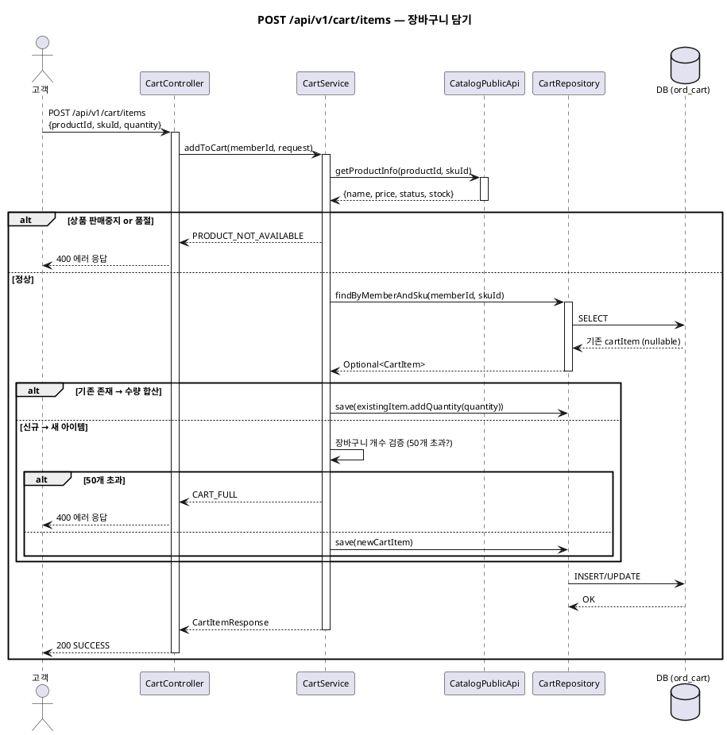

---

## 2. GET /api/v1/cart — 장바구니 조회

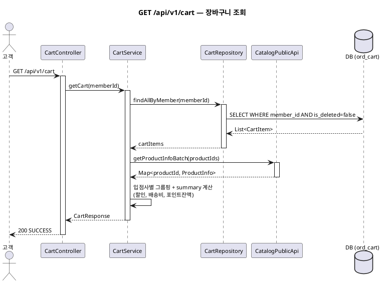

---

## 3. POST /api/v1/orders/sheet — 주문서 생성

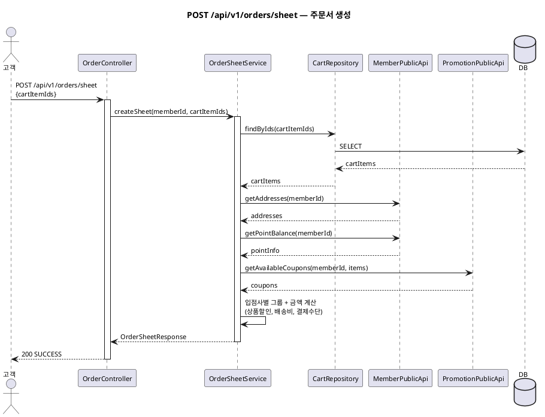

---

## 4. POST /api/v1/orders/{orderSheetId}/pay — 결제 요청

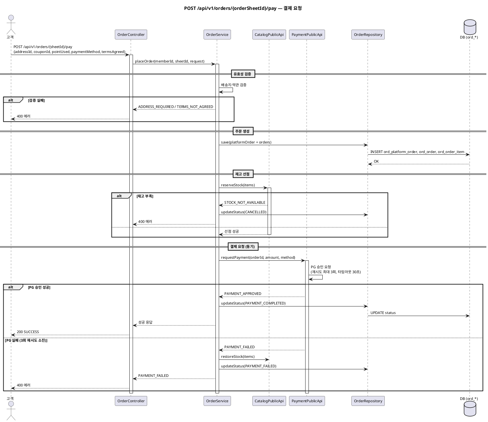

---

## 5. POST /api/v1/orders/{orderId}/cancel — 고객 주문 취소

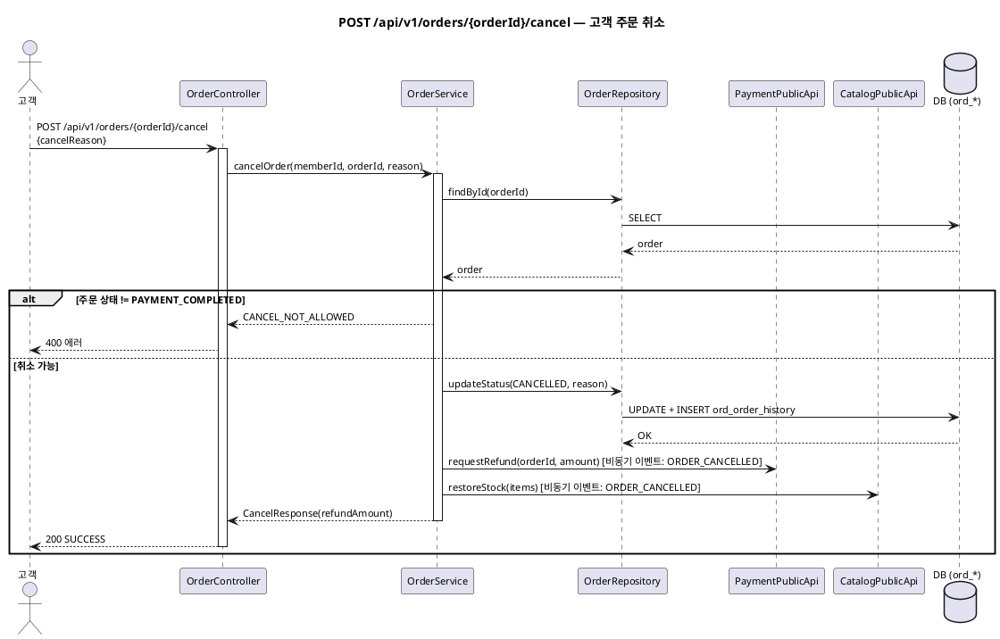

---

## 6. POST /api/v1/orders/{orderId}/confirm — 구매확정

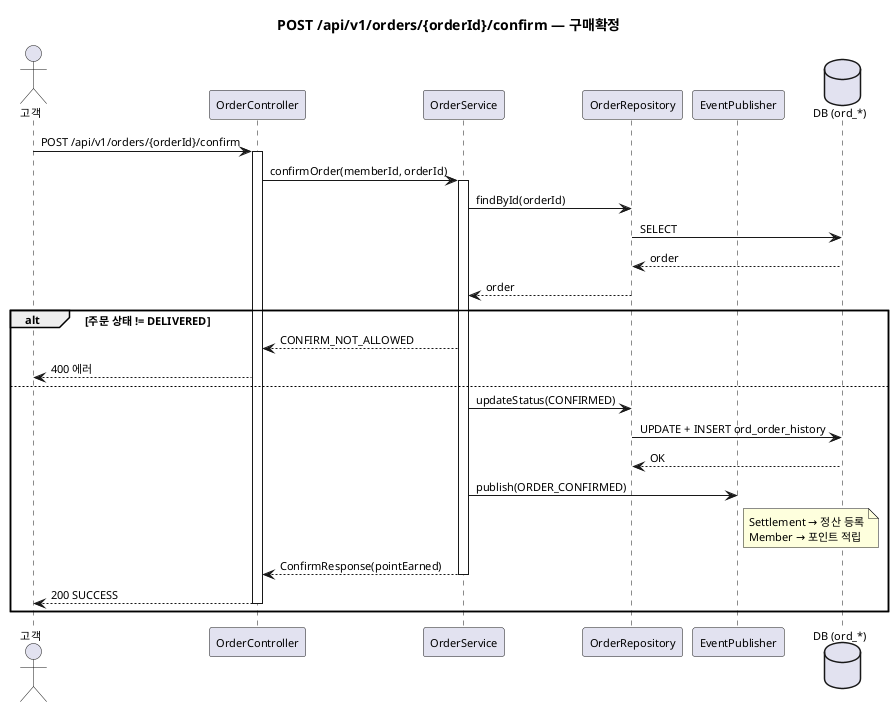

---

## 7. POST /api/v1/orders/{orderId}/claims — 반품/교환 신청

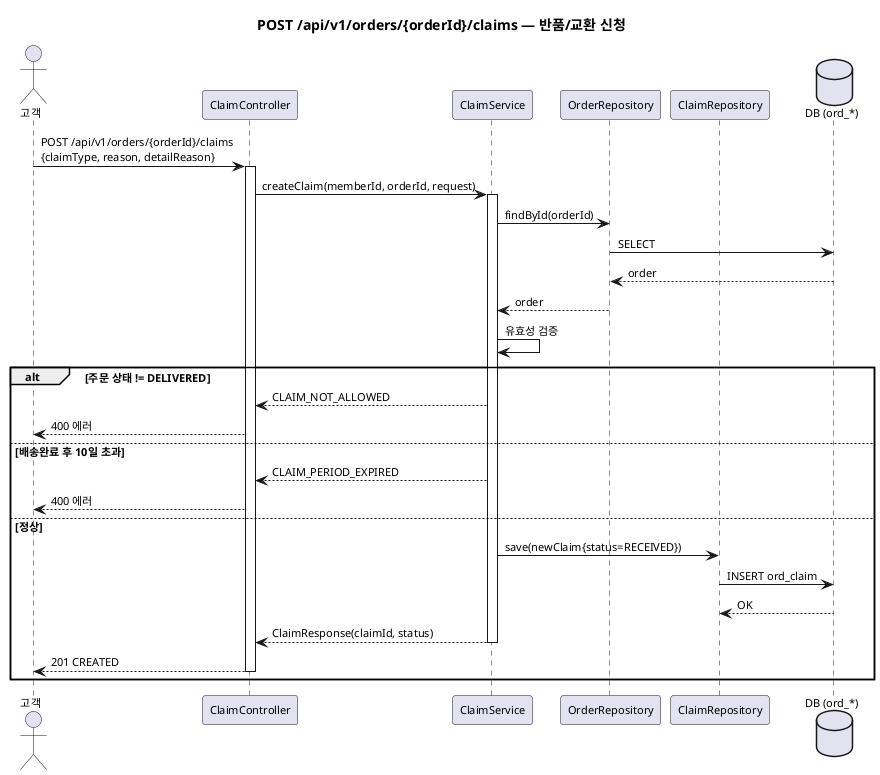

---

## 8. POST /api/partner/v1/orders/{orderId}/ship — 출고 처리

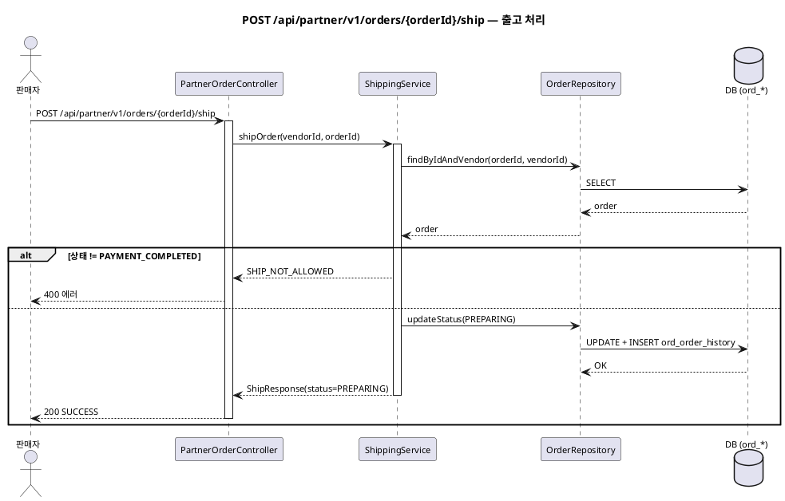

---

## 9. POST /api/partner/v1/shipping/{orderId} — 운송장 등록

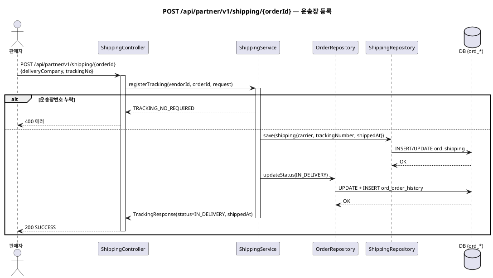

---

## 10. POST /api/admin/v1/claims/{claimId}/complete — 클레임 완료 처리

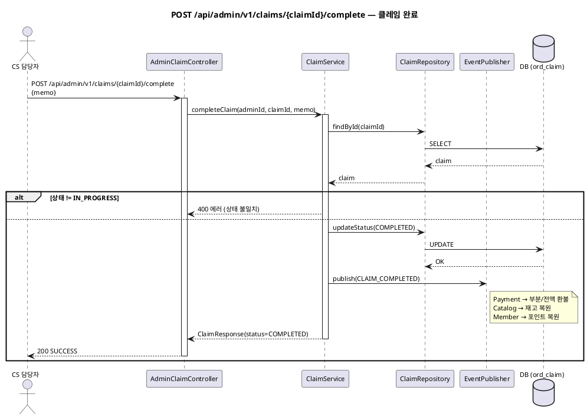

---

## 11. POST /api/admin/v1/orders/{orderId}/force-cancel — CS 예외 취소

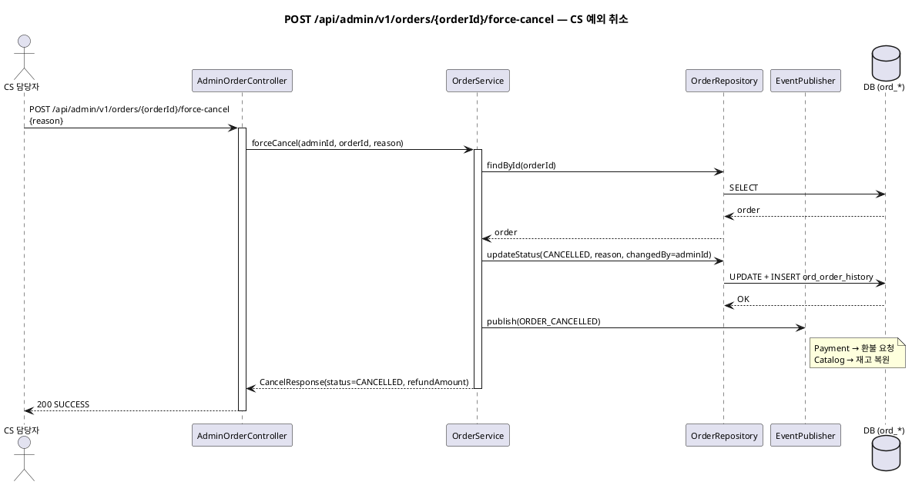

---

## 12. POST /api/v1/claims/{claimId}/shipping-payment — 클레임 배송비 결제

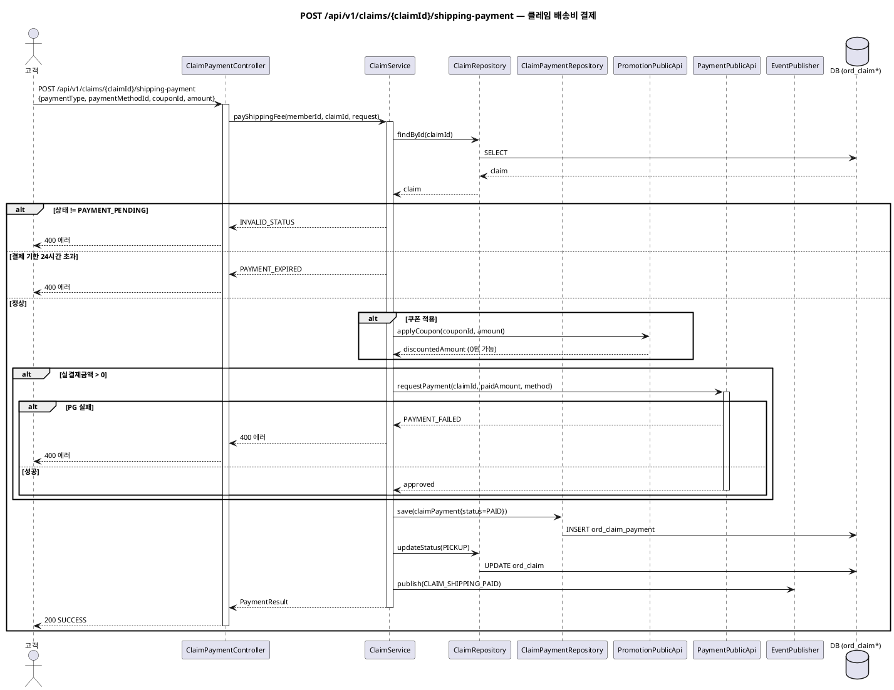

---

## 13. POST /api/admin/v1/claims/{claimId}/refund — 환불 처리

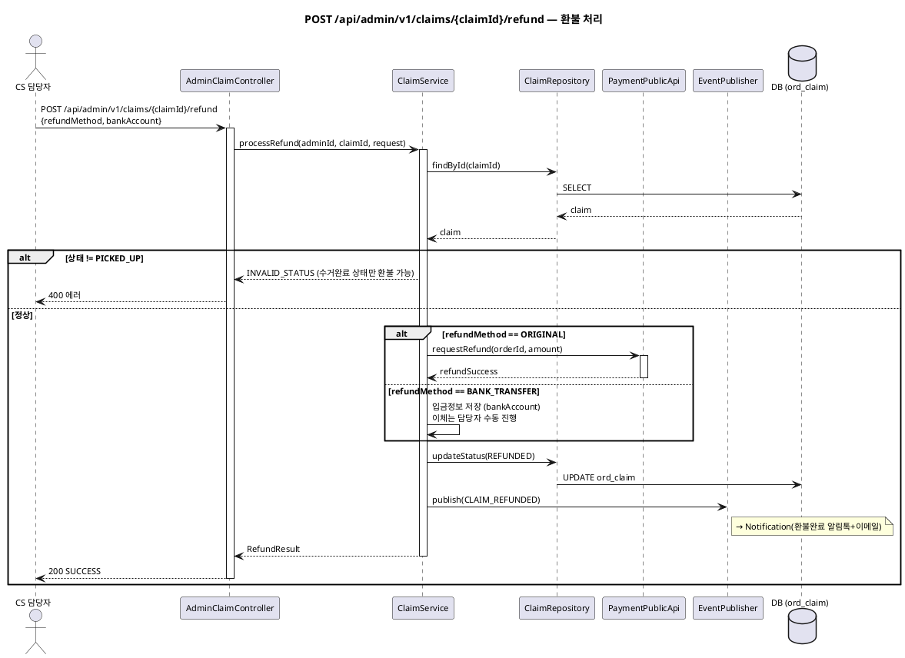

---

## 14. POST /api/partner/v1/claims/{claimId}/inspect-pass — 품질점검 합격

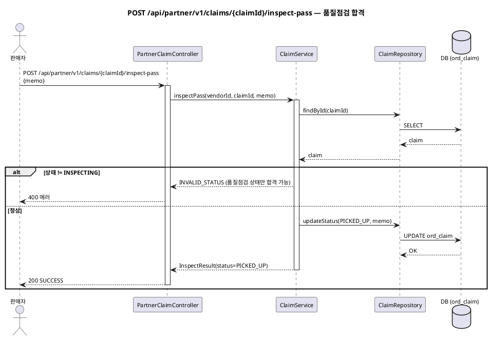

---

## 15. POST /api/partner/v1/claims/{claimId}/inspect-reject — 품질점검 거부

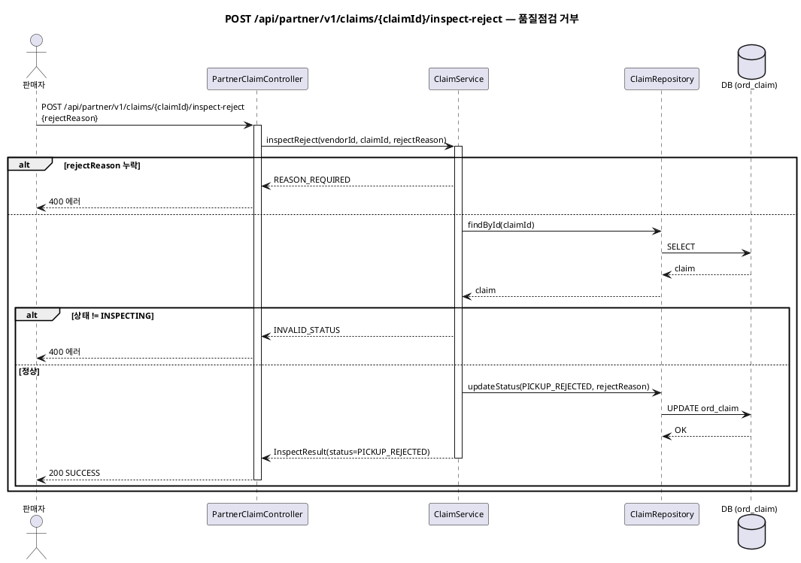

---

## 작성 규칙

| 규칙 | 설명 |
|---|---|
| 1 시퀀스 = 1 API endpoint | 인터페이스 명세의 endpoint와 1:1 |
| 참여자 = 클래스 후보 | Controller, Service, Repository, PublicApi, EventPublisher |
| 트랜잭션 경계 표시 | Service 레벨에서 @Transactional |
| 에러 분기 포함 | 인터페이스 명세의 에러 응답과 대응 |
| 도메인 경계 명시 | 타 도메인 호출은 PublicApi(동기) 또는 EventPublisher(비동기)로 표현 |

---

## 근거

| 항목 | 출처 |
|---|---|
| API endpoint | 인터페이스 명세(⑮) 27개 API 중 주요 11개 상세화 |
| 에러 분기 | GWT(⑬) 예외 시나리오 |
| 도메인 간 호출 | 이벤트 플로우(⑫) 동기/비동기 판단 |
| 참여 객체 | ERD(⑨) 엔티티 + 컴포넌트(③) 모듈 구조 |
| 상태 전이 | 상태머신(⑩) 전이 규칙 |
