# 시퀀스 — 주문·결제 도메인

> **단계**: 상세설계 (S3)  
> **문서범위**: Bolt (Order + Payment)  
> **문서종류**: Design  
>
> **작성 목적**: 인터페이스 명세(DL)의 API를 호출 순서·참여 객체·트랜잭션 경계로 구체화한다.  
> "이 API가 호출되면 내부에서 어떤 순서로 어떤 객체가 상호작용하는가"를 확정한다.
>
> **흐름 내 위치**:
> ```
> DL 인터페이스 명세 → DM 시퀀스 → DN 화면 레이아웃 / DP 클래스 설계
> ```

---

## 공통 규칙 (C3 아키텍처컨벤션 / C5 이벤트설계컨벤션 준수)

### 1. Controller 네이밍 (C3 §4.2)

> 모든 시퀀스의 Controller participant는 **앱별로 분리된 이름**을 사용한다 (Service는 공유).
> `{App}{Domain}Controller` 형식 — 예: `CustomerOrderController`(고객웹), `AdminOrderController`(어드민), `PartnerOrderController`(입점사).
> 이하 다이어그램의 `CustomerCartController`, `CustomerOrderController`, `CustomerClaimController`, `CustomerClaimPaymentController`, `PartnerOrderController`, `PartnerShippingController`, `PartnerClaimController`, `AdminOrderController`, `AdminClaimController`가 이 규칙을 따른다.

### 2. EventPublisher = Outbox 패턴 표현 (C5 §5.1)

> 본 문서의 시퀀스에서 `Service -> EventPublisher : publish(EVENT_NAME)` 호출은
> **"비즈니스 데이터 변경과 동일 트랜잭션 내에서 Outbox 테이블에 이벤트를 저장하는 행위"**를 축약 표현한 것이다.
> 즉 `EventPublisher.publish(...)`는 `outboxRepository.save(OutboxEvent(...))`와 동일 트랜잭션에서 실행되며,
> 실제 Broker(또는 프로토타입의 in-process ApplicationEventPublisher) 발행은 별도의 **Outbox Publisher**가
> Outbox 테이블을 polling(1초 주기)하여 비동기로 수행한다(C5 §5.1~§5.3).
>
> ```
> [Service 트랜잭션]                    [Outbox Publisher (비동기, 별도 프로세스)]
> 1. 비즈니스 데이터 변경                  Outbox 테이블 polling
> 2. EventPublisher.publish(...)   ──▶   → Broker 발행 (프로토타입: ApplicationEvent)
>    = Outbox 테이블 INSERT               → 발행 완료 시 Outbox row 삭제
> 3. COMMIT (1·2 원자적)
> ```
>
> 프로토타입 단계에서는 C5 §5.3에 따라 Outbox 테이블 대신 in-process `ApplicationEventPublisher`를 사용하므로,
> 아래 다이어그램의 `EventPublisher` 참여자는 실 프로젝트 전환 시 `OutboxEventPublisher`(Outbox INSERT) + `OutboxPublisher`(polling·발행) 2단계로 분리된다.
> 컨슈머 측 멱등 처리(`processed_event` 테이블, eventId UNIQUE)는 C5 §6.1을 따른다.

---

## 1. [API] POST /api/v1/cart/items — 장바구니 담기

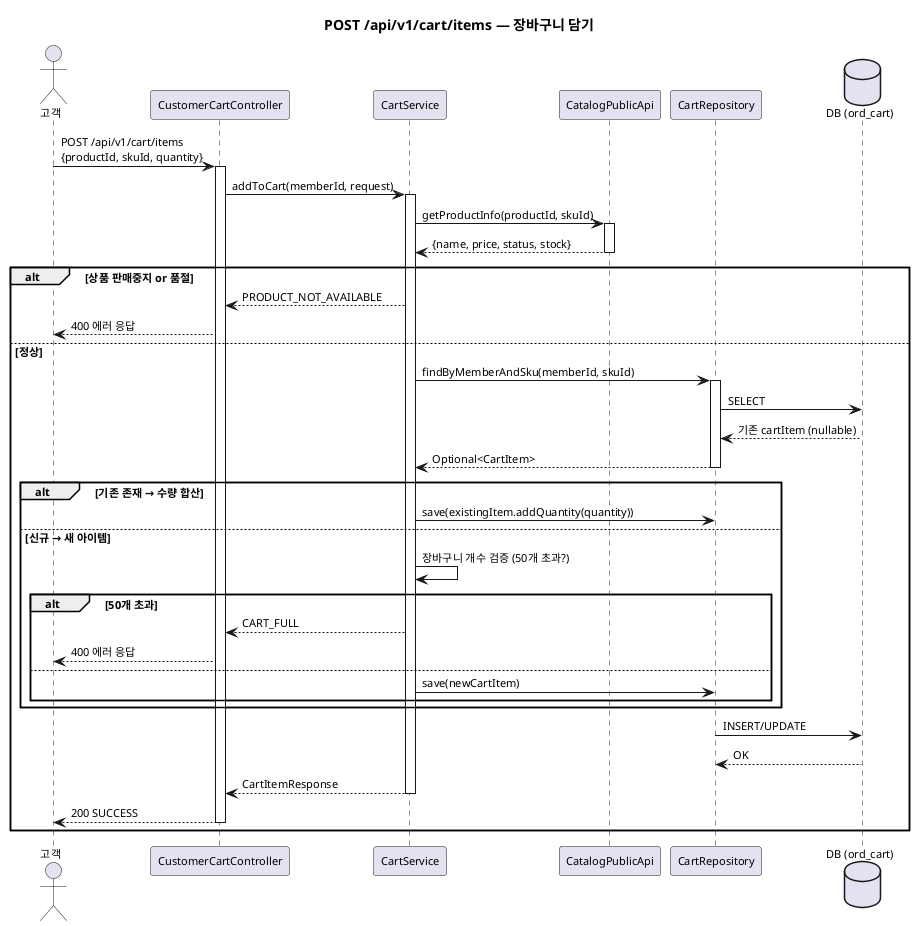

---

## 2. [API] GET /api/v1/cart — 장바구니 조회

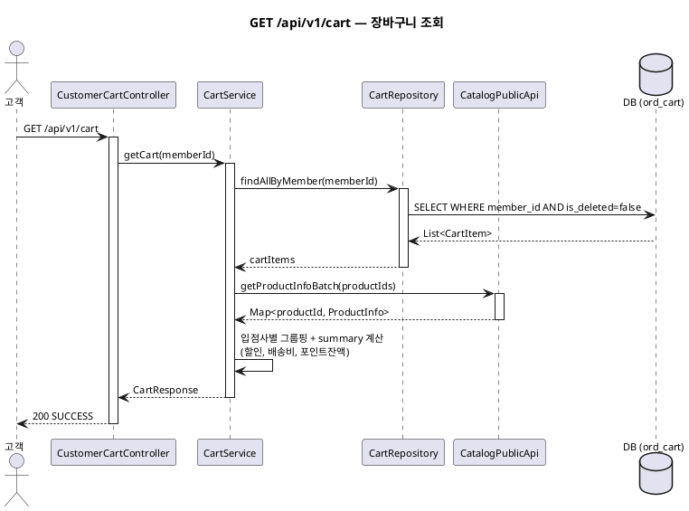

---

## 3. [API] POST /api/v1/orders/sheet — 주문서 생성

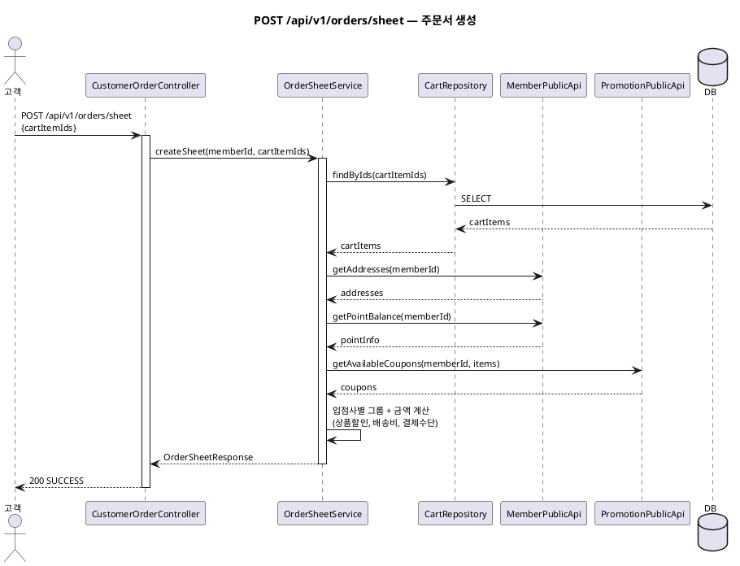

---

## 4. [API] POST /api/v1/orders/{orderSheetId}/pay — 결제 요청

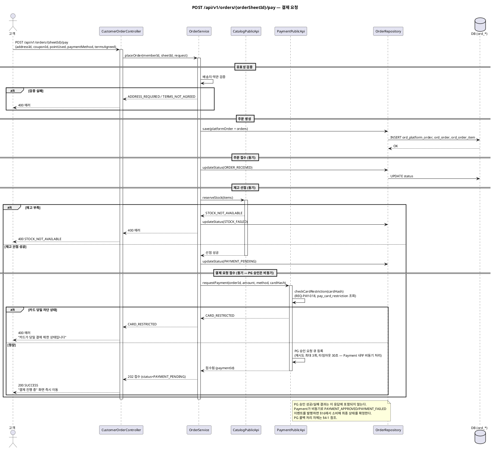

---

## 4-1. [컨슈머] Payment 내부 — PG 콜백 처리 (비동기, 카드 실패 카운터 포함)

> 신규 (2026-08-21 바텀업 재검증): §4에서 "Payment 내부 비동기 처리"로 블랙박스 처리했던 부분을 구체화. REQ-PAY-023(카드 연속실패 카운터)이 여기서 실제로 호출된다.

- **트리거**: PG사 콜백(승인/실패 웹훅) 또는 Payment 자체 재시도 루프 종료
- **상태전이**: Payment `PENDING` → `PAID`(승인) / 재시도 소진 시 그대로 유지하며 `PAYMENT_FAILED` 이벤트만 발행(REQ-PAY-004). `pay_card_fail_counter` 증가(실패) 또는 0 리셋(성공)

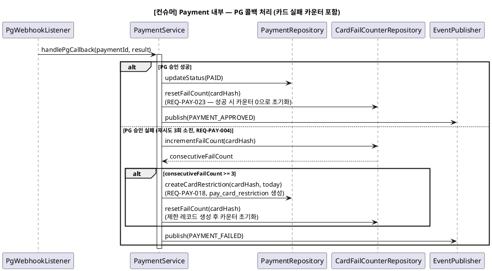

---

## 5. [API] POST /api/v1/orders/{orderId}/cancel — 고객 주문 취소

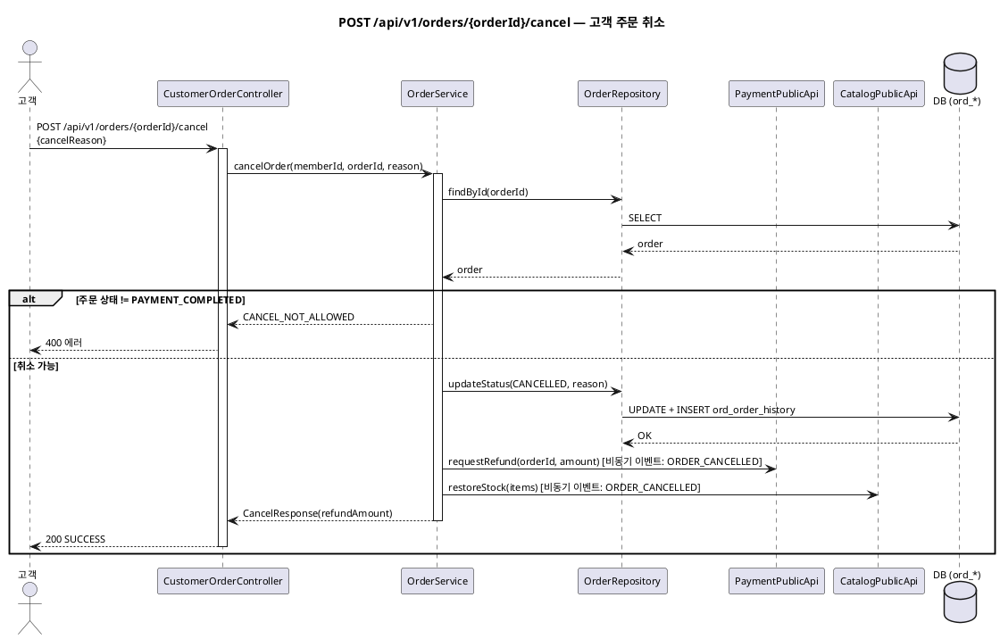

---

## 6. [API] POST /api/v1/orders/{orderId}/confirm — 구매확정

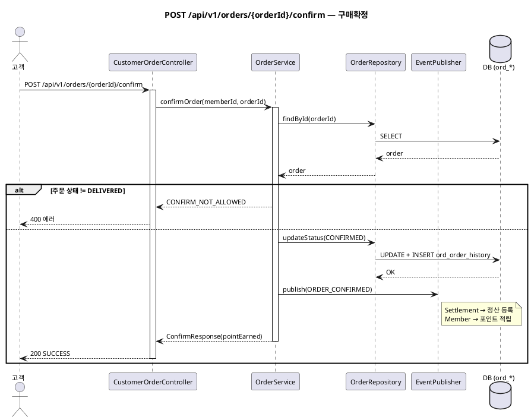

---

## 7. [API] POST /api/v1/orders/{orderId}/claims — 반품/교환 신청

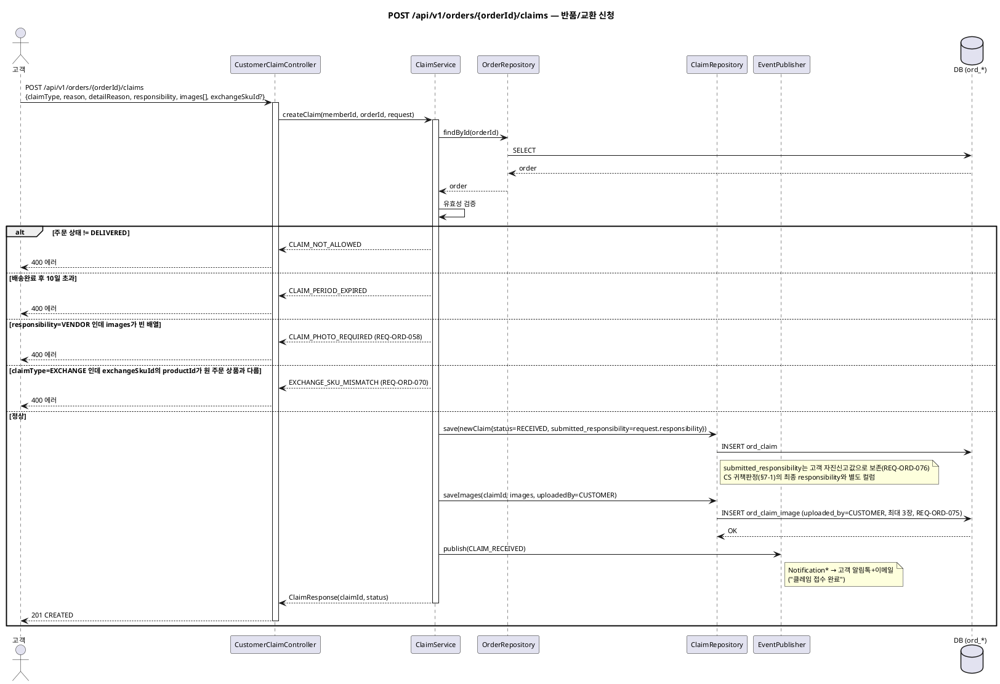

---

## 7-1. [API] POST /api/admin/v1/claims/{claimId}/blame-decision — 귀책 판정

> 신규 (2026-08-21 바텀업 재검증): 인터페이스명세(DL) §19-1에는 있었지만 시퀀스가 없던 것을 보완. CUSTOMER/VENDOR 분기와 EXCHANGE 재고선점 실패(REQ-ORD-069)까지 포함한 전체 분기를 다룬다.

- **트리거**: CS 담당자가 클레임 접수 내용을 확인하고 귀책을 확정
- **상태전이**: Claim `RECEIVED` → `PAYMENT_PENDING`(CUSTOMER) / `RECEIVED` 유지 + shipment(PICKUP) 생성 → 이후 §12/§14 경유 `INSPECTING`(VENDOR)

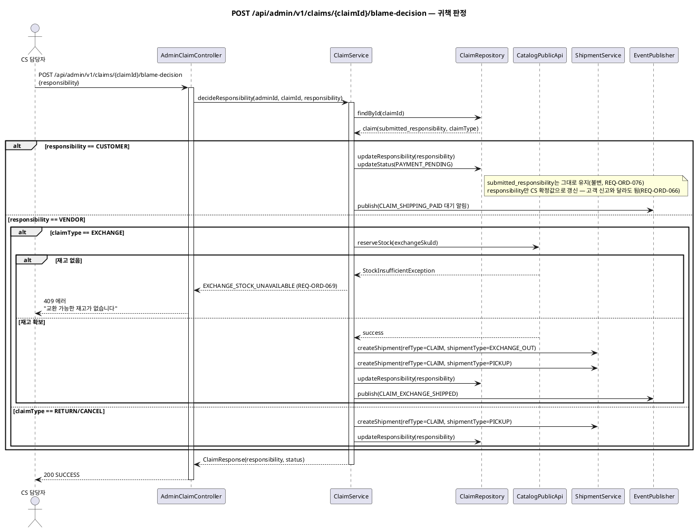

---

## 7-2. [API] POST /api/v1/claims/{claimId}/cancel — 고객 클레임 자진 취소

> 신규 (2026-08-21 바텀업 재검증): REQ-ORD-073/071 대응. RECEIVED/PAYMENT_PENDING 상태까지만 허용, INSPECTING 이후는 거부.

- **트리거**: 고객이 마이페이지 클레임상세에서 취소 요청
- **상태전이**: Claim `RECEIVED`/`PAYMENT_PENDING` → `REJECTED`(사유="고객 자진 철회")

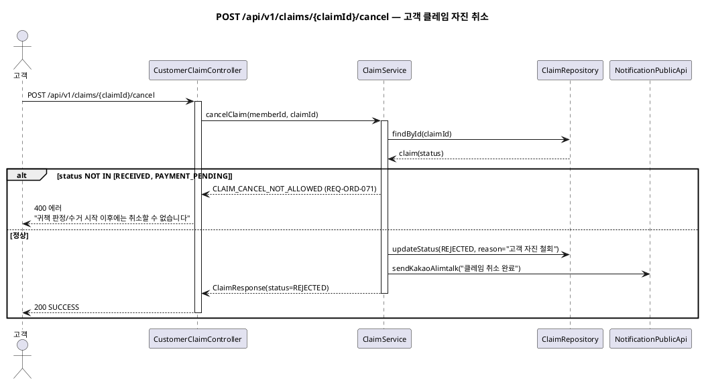

---

## 8. [API] POST /api/partner/v1/orders/{orderId}/ship — 출고 처리

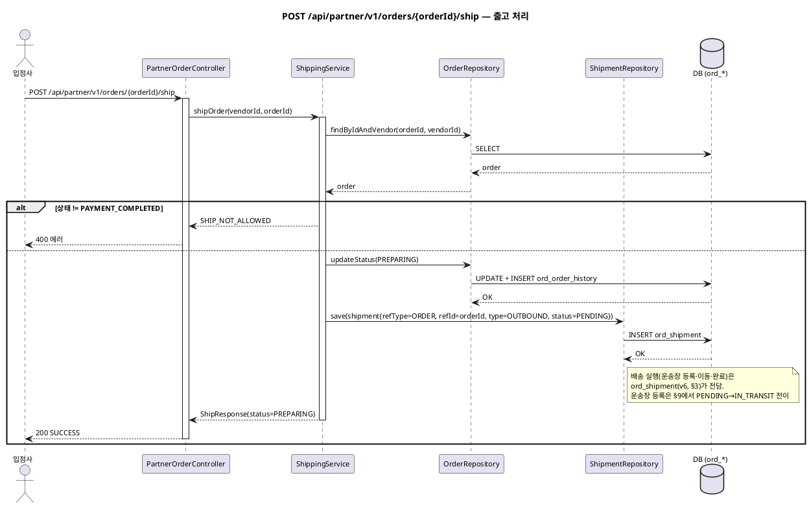

---

## 9. [API] POST /api/partner/v1/shipping/{orderId} — 운송장 등록

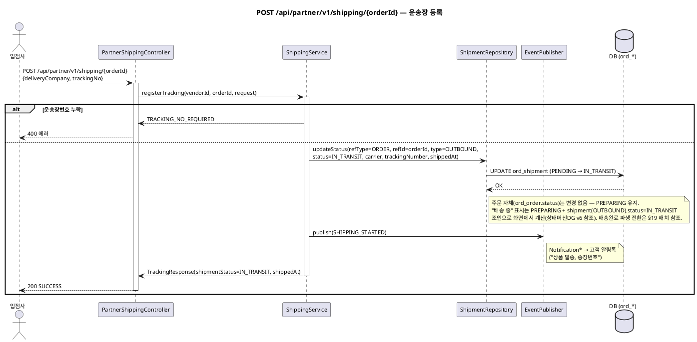

---

## 10. [배치] 클레임 자동완료 — REFUNDED/DISPOSED → COMPLETED

- **트리거**: 스케줄러 (매 시간 정각)
- **상태전이**: Claim `REFUNDED` → `COMPLETED`, Claim `DISPOSED` → `COMPLETED` (배치 자동 전환)
- **비고**: 14상태 모델(DG)에는 어드민이 직접 호출하는 "클레임 완료" API가 없다. `PICKED_UP → REFUNDED`는 §13(환불 처리), `PICKUP_REJECTED → DISPOSED`는 §20(폐기 처리)에서 각각 어드민이 수행하고, `REFUNDED`/`DISPOSED`에 도달한 클레임은 본 배치가 주기적으로 스캔해 `COMPLETED`로 자동 전환한다. `RETURN_PAYMENT_PENDING → COMPLETED`(shipment(RETURN) DELIVERED 기준) 자동전환은 택배사 반송완료 확인과 같은 배치에서 처리하므로 §19를 참조.

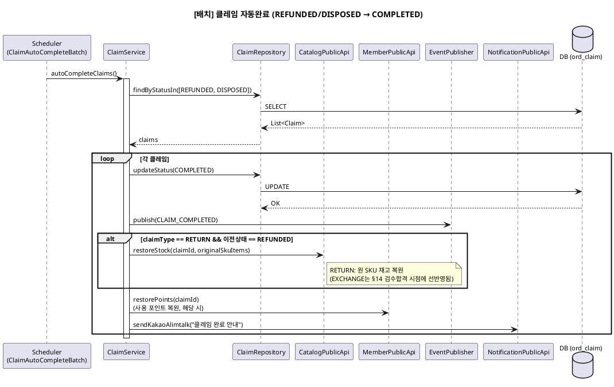

---

## 11. [API] POST /api/admin/v1/orders/{orderId}/force-cancel — CS 예외 취소

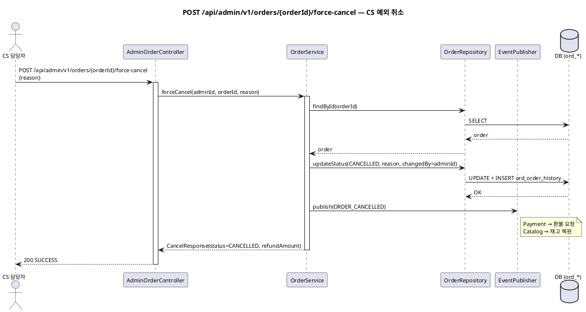

---

## 12. [API] POST /api/v1/claims/{claimId}/shipping-payment — 클레임 배송비 결제

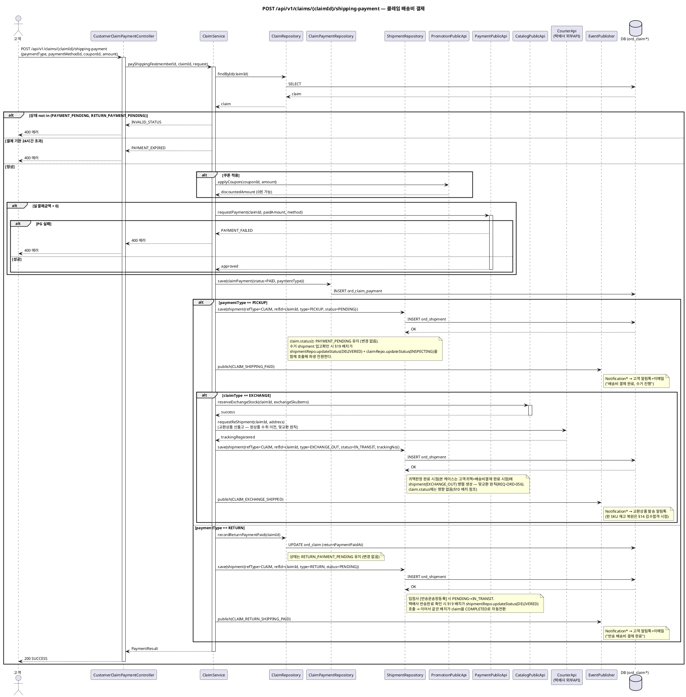

---

## 13. [API] POST /api/admin/v1/claims/{claimId}/refund — 환불 처리

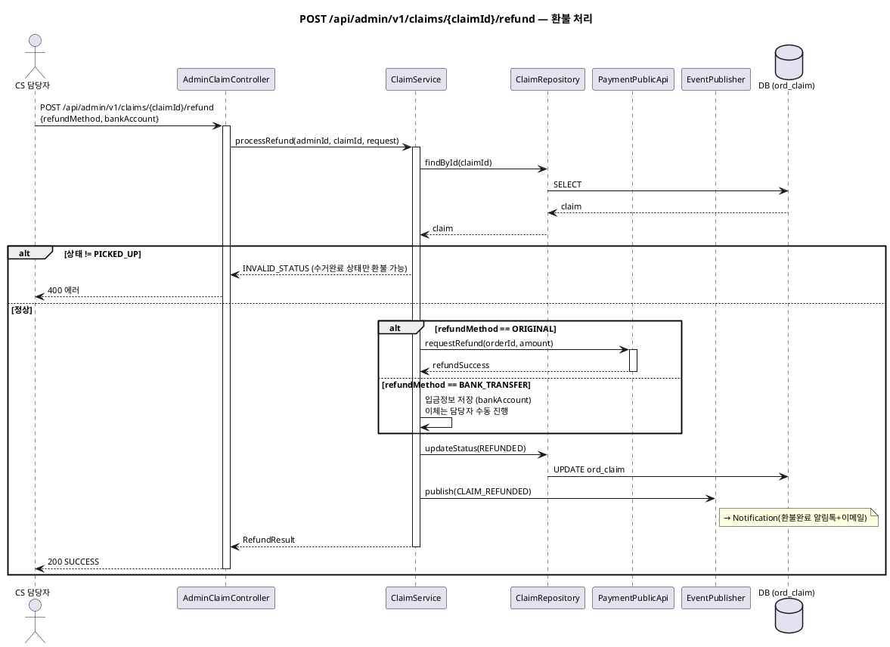

---

## 14. [API] POST /api/partner/v1/claims/{claimId}/inspect-pass — 품질점검 합격

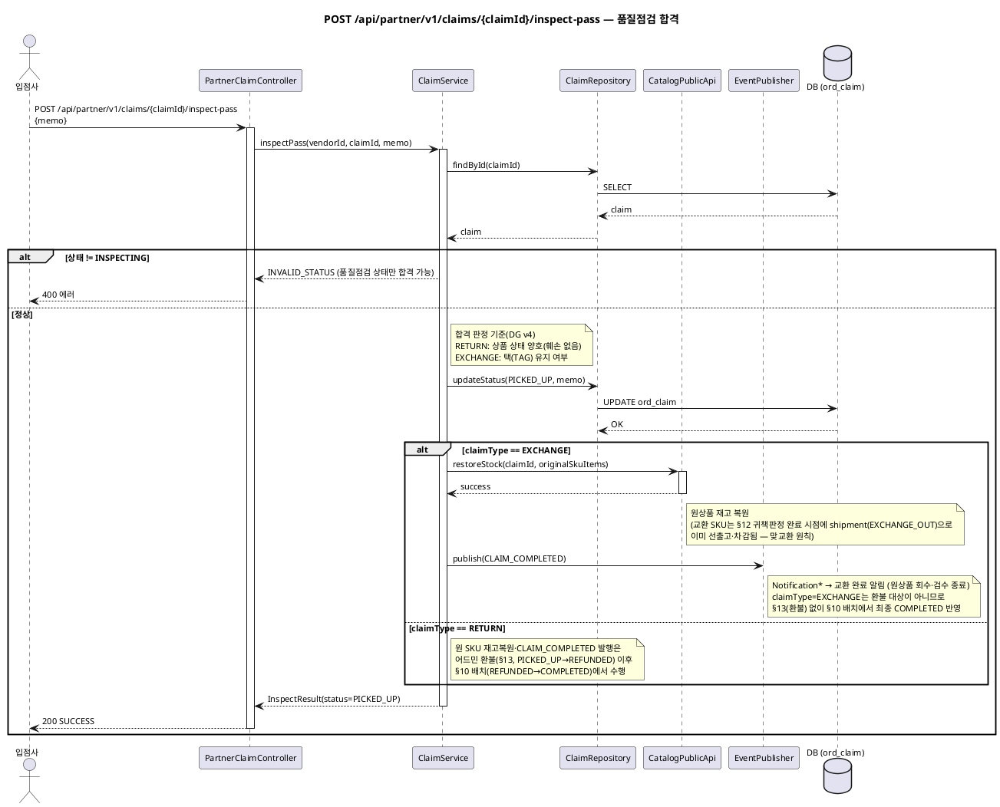

---

## 15. [API] POST /api/partner/v1/claims/{claimId}/inspect-reject — 품질점검 거부

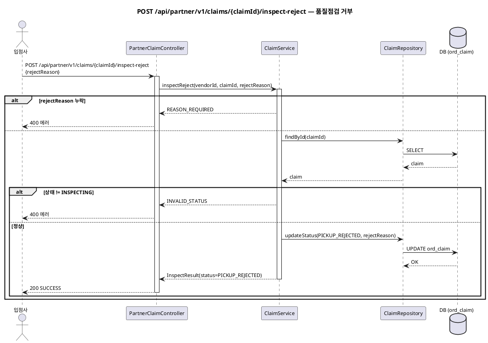

---

## 16. [컨슈머] PAYMENT_APPROVED/PAYMENT_FAILED 이벤트 수신 — 결제 완료·실패 후처리

> v2 (2026-08-21 현행화): 재고선점은 §4(결제 요청)에서 이미 완료된 상태이므로 이 컨슈머는 재고 호출을 하지 않는다. 상태전이도 REQ-ORD-013/014에 맞게 `PAYMENT_PENDING→PAYMENT_COMPLETED`/`PAYMENT_FAILED`로 정정(구모델 `ORDER_RECEIVED`/`ORDER_FAILED` 제거).

- **트리거**: Payment 도메인 → `PAYMENT_APPROVED` 또는 `PAYMENT_FAILED` 이벤트 발행
- **세부UC 참조**: [주문접수] UC-ORD-004 결제완료 후처리
- **상태전이**: Order `PAYMENT_PENDING` → `PAYMENT_COMPLETED`(승인) / `PAYMENT_FAILED`(실패, REQ-ORD-014)

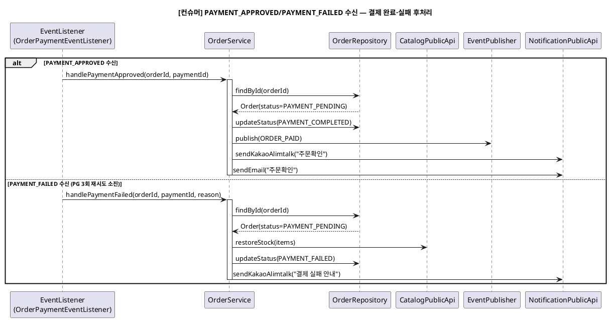

---

## 17. [배치] D+7 자동구매확정 — 배송완료 후 7일 경과

- **트리거**: 스케줄러 (매일 02:00)
- **세부UC 참조**: [구매확정] UC-ORD-006 자동구매확정
- **상태전이**: Order `DELIVERED` → `CONFIRMED` (Payment 상태는 변경 없음 — 정산은 Settlement 도메인이 `ORDER_CONFIRMED` 이벤트를 구독해 비동기 처리)

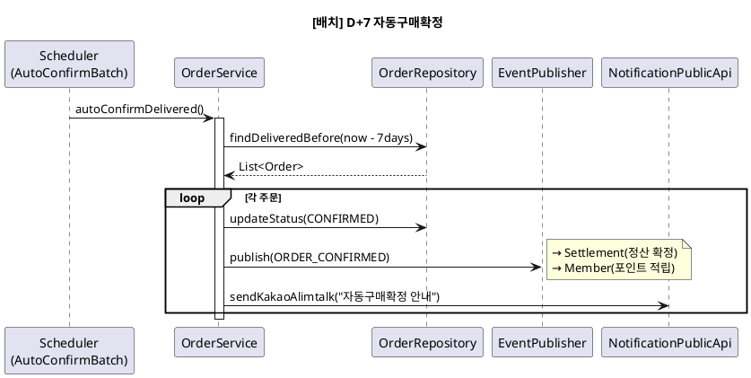

---

## 18. [배치] 배송비결제 24시간 만료 — 미결제 클레임 자동취소

- **트리거**: 스케줄러 (매 시간 정각)
- **세부UC 참조**: [클레임접수] UC-ORD-012 배송비 결제기한 만료
- **상태전이**: Claim `PAYMENT_PENDING` → `PAYMENT_EXPIRED`

```plantuml
@startuml
title [배치] 배송비결제 24시간 만료

participant "Scheduler\n(ShippingPaymentExpiryBatch)" as Batch
participant "ClaimService" as Service
participant "ClaimRepository" as Repo
participant "ClaimPaymentRepository" as PayRepo
participant "EventPublisher" as Event
participant "NotificationPublicApi" as Noti

Batch -> Service : expireUnpaidShippingFees()
activate Service

Service -> PayRepo : findPendingExpiredBefore(now)
PayRepo --> Service : List<ClaimPayment>(status=PENDING, expired_at < now)

loop 각 미결제 건
    Service -> Repo : updateClaimStatus(PAYMENT_EXPIRED)
    Service -> PayRepo : updatePaymentStatus(EXPIRED)
    Service -> Event : publish(CLAIM_PAYMENT_EXPIRED)
    Service -> Noti : sendKakaoAlimtalk("배송비 미결제로 클레임 취소")
end

deactivate Service
@enduml
```

---

## 18-1. [배치] RECEIVED 24시간 CS 미처리 리마인드

> 신규 (2026-08-21 바텀업 재검증): REQ-ORD-068 대응. 지금까지는 화면 대시보드 집계 표시만 있고 실제 발송 배치가 없었다.

- **트리거**: 스케줄러 (매 시간 정각)
- **세부UC 참조**: [클레임접수] CS 접수확인 SLA
- **상태전이**: 없음 (알림만 발송, claim.status는 RECEIVED 유지)

```plantuml
@startuml
title [배치] RECEIVED 24시간 CS 미처리 리마인드

participant "Scheduler\n(ClaimReceivedSlaBatch)" as Batch
participant "ClaimService" as Service
participant "ClaimRepository" as Repo
participant "NotificationPublicApi" as Noti

Batch -> Service : remindUnprocessedReceived()
activate Service

Service -> Repo : findByStatusAndCreatedBefore(RECEIVED, now - 24h)
Repo --> Service : List<Claim>

loop 각 미처리 클레임 (last_reminded_at이 24h 이상 지났거나 NULL인 건만)
    Service -> Noti : sendAdminAlert("접수 24시간 경과 미처리 클레임", claimId)
    Service -> Repo : updateLastRemindedAt(now)
    note right of Noti: CS 대시보드 "미처리임박" 집계(DN-화면레이아웃)의 실제 발송 트리거
end

deactivate Service
@enduml
```

---

## 19. [배치] 배송상태 갱신 — 택배사 API 조회 (60분 주기)

- **트리거**: 스케줄러 (매 60분)
- **세부UC 참조**: [배송관리] UC-ORD-008 배송상태 동기화
- **상태전이**: `ord_shipment.status` `IN_TRANSIT` → `DELIVERED`/`FAILED` (v6, 배송 실행 전용·order/claim 공용). 파생 전환: Order `PREPARING` → `DELIVERED`(shipment type=OUTBOUND 구독), Claim `PAYMENT_PENDING`/`INSPECTING` 진입(shipment type=PICKUP 구독), Claim `RETURN_PAYMENT_PENDING` → `COMPLETED`(shipment type=RETURN 구독)

```plantuml
@startuml
title [배치] 배송상태 갱신 (60분 주기, v6 — ord_shipment 전용)

participant "Scheduler\n(ShipmentStatusSyncBatch)" as Batch
participant "ShipmentService" as Service
participant "ShipmentRepository" as Repo
participant "CourierApi\n(택배사 외부API)" as Courier
participant "ClaimRepository" as ClaimRepo
participant "OrderRepository" as OrderRepo
participant "EventPublisher" as Event
participant "NotificationPublicApi" as Noti

Batch -> Service : syncShipmentStatus()
activate Service

Service -> Repo : findByStatus(IN_TRANSIT)
Repo --> Service : List<Shipment>(shipment_type IN [OUTBOUND, PICKUP, RETURN, EXCHANGE_OUT])

loop 각 배송건
    Service -> Courier : getTrackingStatus(trackingNo)
    Courier --> Service : TrackingResult

    alt 배송완료
        Service -> Repo : updateStatus(DELIVERED)
        Repo -> Repo : (DB) UPDATE ord_shipment

        alt shipment_type == OUTBOUND
            Service -> Event : publish(SHIPMENT_DELIVERED, refType=ORDER, refId=orderId)
            note right of Event: order.status는 이 배치가 직접 갱신하지 않는다.\nOrderService가 이벤트를 구독해 파생 전환(아래 == 섹션 참조) — 2단계 분리
            Service -> Noti : sendKakaoAlimtalk("배송완료 안내")
        else shipment_type == PICKUP
            Service -> ClaimRepo : updateStatus(INSPECTING)
            note right of ClaimRepo: claim.status PAYMENT_PENDING 또는 RECEIVED(입점사귀책)\n→ INSPECTING. shipmentRepo.updateStatus(DELIVERED)와\n같은 트랜잭션에서 함께 호출(§12 참조)
            Service -> Noti : sendKakaoAlimtalk("수거완료, 품질점검 진행 안내")
        else shipment_type == RETURN
            note right of Service: claim.status는 변경하지 않음(RETURN_PAYMENT_PENDING 유지)\nCOMPLETED 자동전환은 아래 "클레임 자동완료" 섹션에서 별도 처리
            Service -> Noti : sendKakaoAlimtalk("반송 배송완료 안내")
        else shipment_type == EXCHANGE_OUT
            note right of Service: claim.status 영향 없음\n(교환상품 발송 완료, 맞교환 원칙 — §12/§14 참조)
            Service -> Noti : sendKakaoAlimtalk("교환상품 배송완료 안내")
        end
    else 배송실패/반송 신호
        Service -> Repo : updateStatus(FAILED)
        Repo -> Repo : (DB) UPDATE ord_shipment
        Service -> Noti : sendKakaoAlimtalk("배송 실패 안내, CS 확인 요청")
    else 상태변경 없음
        note right: skip
    end
end

== 주문 배송완료 파생 전환 (OrderService, SHIPMENT_DELIVERED 이벤트 구독) ==

Event -> OrderRepo : updateStatus(DELIVERED)\n(shipment type=OUTBOUND 구독분만, orderId 기준)
OrderRepo -> OrderRepo : (DB) UPDATE ord_order
note right of OrderRepo: D+7 자동확정 타이머 시작(§17), 고객 알림톡

== 클레임 자동완료 (RETURN_PAYMENT_PENDING → COMPLETED, shipment(RETURN) DELIVERED 기준 배치 자동전환) ==

Service -> ClaimRepo : findByStatusWithReturnShipmentDelivered(RETURN_PAYMENT_PENDING)
ClaimRepo --> Service : List<Claim>(연관 shipment(RETURN).status = DELIVERED)

loop 각 클레임 (CLAIM_REFUNDED류 알림톡 발행 패턴 참고)
    Service -> ClaimRepo : updateStatus(COMPLETED)
    Service -> Event : publish(CLAIM_COMPLETED)
    Service -> Noti : sendKakaoAlimtalk("클레임 완료 안내")
end

deactivate Service
@enduml
```

---

## 20. [API] POST /api/admin/v1/claims/{claimId}/dispose — 폐기 처리

- **트리거**: 어드민 수동 처리 (품질점검 불합격 건 중 반송 불가 판단)
- **상태전이**: Claim `PICKUP_REJECTED` → `DISPOSED`

```plantuml
@startuml
skinparam backgroundColor transparent
skinparam defaultFontSize 11
title POST /api/admin/v1/claims/{claimId}/dispose — 폐기 처리

actor "CS 담당자" as Admin
participant "AdminClaimController" as ACC
participant "ClaimService" as CS
participant "ClaimRepository" as CR
participant "EventPublisher" as EP
database "DB (ord_claim)" as DB

Admin -> ACC : POST /api/admin/v1/claims/{claimId}/dispose\n{reason}
activate ACC

ACC -> CS : disposeClaim(adminId, claimId, reason)
activate CS

CS -> CR : findById(claimId)
CR -> DB : SELECT
DB --> CR : claim
CR --> CS : claim

alt 상태 != PICKUP_REJECTED
  CS --> ACC : INVALID_STATUS (품질점검 거부 건만 폐기 가능)
  ACC --> Admin : 400 에러
else 정상
  CS -> CR : updateStatus(DISPOSED, reason)
  CR -> DB : UPDATE ord_claim

  CS -> EP : publish(CLAIM_DISPOSED)
  note right of EP: Notification* → 고객 알림톡\n("상품 폐기 처리됨")\nDISPOSED→COMPLETED 자동전환은 §10 배치 참조

  CS --> ACC : ClaimResponse(status=DISPOSED)
  deactivate CS
  ACC --> Admin : 200 SUCCESS
  deactivate ACC
end

@enduml
```

---

## 21. [API] POST /api/admin/v1/claims/{claimId}/request-return-payment — 반송 배송비 추가결제 요청

- **트리거**: 어드민 수동 처리 (품질점검 불합격 건 중 반송 가능 판단)
- **상태전이**: Claim `PICKUP_REJECTED` → `RETURN_PAYMENT_PENDING`

```plantuml
@startuml
skinparam backgroundColor transparent
skinparam defaultFontSize 11
title POST /api/admin/v1/claims/{claimId}/request-return-payment — 반송 배송비 추가결제 요청

actor "CS 담당자" as Admin
participant "AdminClaimController" as ACC
participant "ClaimService" as CS
participant "ClaimRepository" as CR
participant "EventPublisher" as EP
database "DB (ord_claim)" as DB

Admin -> ACC : POST /api/admin/v1/claims/{claimId}/request-return-payment\n{amount}
activate ACC

ACC -> CS : requestReturnPayment(adminId, claimId, amount)
activate CS

CS -> CR : findById(claimId)
CR -> DB : SELECT
DB --> CR : claim
CR --> CS : claim

alt 상태 != PICKUP_REJECTED
  CS --> ACC : INVALID_STATUS (품질점검 거부 건만 반송 요청 가능)
  ACC --> Admin : 400 에러
else 정상
  CS -> CR : updateStatus(RETURN_PAYMENT_PENDING, amount)
  CR -> DB : UPDATE ord_claim

  CS -> EP : publish(CLAIM_RETURN_PAYMENT_REQUESTED)
  note right of EP: Notification* → 고객 알림톡\n("반송 배송비 결제 필요")\n고객 결제는 §12(paymentType=RETURN)에서 처리\n24시간 미결제 시 §18 배치가 PAYMENT_EXPIRED로 자동취소

  CS --> ACC : ClaimResponse(status=RETURN_PAYMENT_PENDING)
  deactivate CS
  ACC --> Admin : 200 SUCCESS
  deactivate ACC
end

@enduml
```

---

## 22. [API] POST /api/partner/v1/shipping/{shipmentId}/reship — 배송 실패 재발송 처리 (신규)

> v6 후속 보완 (2026-08-21): REQ-ORD-062 대응. FAILED 상태의 shipment(어떤 shipment_type이든 공통)를 재발송 처리한다.

- **트리거**: 입점사 또는 CS 담당자 수동 처리 (§19 배치가 FAILED로 전환한 건)
- **상태전이**: `ord_shipment.status` `FAILED` → `PENDING` → (운송장 재등록 시) `IN_TRANSIT`

```plantuml
@startuml
skinparam backgroundColor transparent
skinparam defaultFontSize 11
title POST /api/partner/v1/shipping/{shipmentId}/reship — 배송 실패 재발송 처리

actor "입점사 / CS 담당자" as Actor
participant "PartnerShippingController" as SC
participant "ShipmentService" as Service
participant "ShipmentRepository" as Repo
database "DB (ord_shipment)" as DB

Actor -> SC : POST /api/partner/v1/shipping/{shipmentId}/reship\n{carrier, trackingNo}
activate SC

SC -> Service : reship(shipmentId, carrier, trackingNo)
activate Service

Service -> Repo : findById(shipmentId)
Repo --> Service : Shipment

alt 상태 != FAILED
  Service --> SC : RESHIP_NOT_ALLOWED (FAILED 상태만 재발송 가능)
  SC --> Actor : 400 에러
else 정상
  Service -> Repo : updateStatus(PENDING)
  Repo -> DB : UPDATE ord_shipment
  Service -> Repo : registerTracking(carrier, trackingNo)
  Repo -> DB : UPDATE ord_shipment (carrier, trackingNo)
  Service -> Repo : updateStatus(IN_TRANSIT)
  Repo -> DB : UPDATE ord_shipment
  note right: 이후 §19 배치가 다시 추적(60분 주기)

  Service --> SC : ShipmentResponse(status=IN_TRANSIT)
  deactivate Service
  SC --> Actor : 200 SUCCESS
  deactivate SC
end

@enduml
```

---

## 작성 규칙

| 규칙 | 설명 |
|---|---|
| 1 시퀀스 = 1 트리거 | API endpoint, 이벤트 수신, 스케줄 배치 각각 1개 시퀀스 |
| 태그로 유형 구분 | `[API]` 사용자 요청, `[컨슈머]` 이벤트 수신, `[배치]` 스케줄러 |
| 참여자 = 클래스 후보 | Controller/Listener/Scheduler, Service, Repository, PublicApi, EventPublisher |
| 트랜잭션 경계 표시 | Service 레벨에서 @Transactional |
| 에러 분기 포함 | 인터페이스 명세의 에러 응답과 대응 |
| 도메인 경계 명시 | 타 도메인 호출은 PublicApi(동기) 또는 EventPublisher(비동기)로 표현 |
| Controller 네이밍 | 앱별 분리 — `{App}{Domain}Controller` (C3 §4.2, 상단 공통 규칙 §1 참조) |
| EventPublisher 표현 | Outbox 패턴 축약 표현 — 비즈니스 변경과 동일 트랜잭션 (C5 §5.1, 상단 공통 규칙 §2 참조) |

---

## 근거

| 항목 | 출처 |
|---|---|
| API endpoint | 인터페이스 명세(DL) 27개 API 중 주요 15개 상세화 |
| 컨슈머 시퀀스 | 이벤트 플로우(DI) PAYMENT_APPROVED 수신 액션 |
| 배치 시퀀스 | EARS(DE) REQ-ORD-006(D+7 자동확정), REQ-ORD-041(24시간 만료) |
| 에러 분기 | GWT(DJ) 예외 시나리오 |
| 도메인 간 호출 | 이벤트 플로우(DI) 동기/비동기 판단 |
| 참여 객체 | ERD(DF) 엔티티 + 컴포넌트(D9) 모듈 구조 |
| 상태 전이 | 상태머신(DG) 전이 규칙 |
| Controller 네이밍 | C3 아키텍처컨벤션 §4.2 (앱별 Controller 분리) |
| Outbox 패턴 | C5 이벤트설계컨벤션 §5.1 (비즈니스 변경 + Outbox 저장 = 동일 트랜잭션) |
