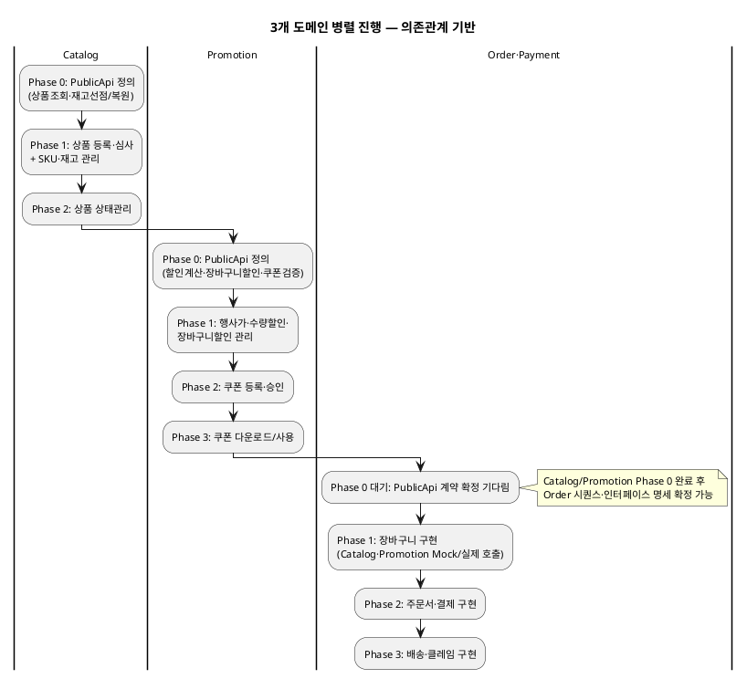

# 도메인 간 우선 업무 및 의존관계 (1차: Order·Payment 본개발 기준)

| 항목 | 내용 |
|---|---|
| 문서 유형 | 기술참조 (Tasks 공정 — WBS·의존성맵 입력자료) |
| 작성일 | 2026-07-30 |
| 전제 | 1차 본개발 대상: Order·Payment. 연관 도메인(Catalog·Promotion)은 Mock→점진 실구현 |

---

## 1. 문제

Order·Payment 도메인을 본개발하려면 Catalog·Promotion의 **일부 기능이 먼저 정의·구현**되어야 합니다.
3개 도메인이 동시에 진행하되, 서로의 블로킹을 최소화하려면 **우선 업무와 의존 관계**가 명확해야 합니다.

---

## 2. Order가 호출하는 Catalog PublicApi

| Order EARS | Catalog에서 필요한 것 | Catalog 소분류 | 우선순위 |
|---|---|---|---|
| REQ-ORD-059 (담기 시 유효성 검증) | 상품 판매상태·재고·옵션 확인 | 재고 존재 여부 API + 상품 상세 조회 | **P1** |
| REQ-ORD-064 (유효성 재검사) | 품절 SKU 확인 | 재고 존재 여부 API | **P1** |
| REQ-ORD-057 (재고 선점) | 재고 차감 | 재고 자동 차감/복구(컨슈머) | **P1** |
| REQ-ORD-006/058 (취소·실패 시 복원) | 재고 복원 | 재고 자동 차감/복구(컨슈머) | **P1** |
| REQ-ORD-035 (반품 재고 복구) | 재고 수동 복구 | 재고 자동 차감/복구(컨슈머) | P2 |
| REQ-ORD-060 (장바구니 조회) | 상품명·이미지·옵션명 조회 | 상품 상세 조회(고객) | **P1** |

---

## 3. Order가 호출하는 Promotion PublicApi

| Order EARS | Promotion에서 필요한 것 | Promotion 소분류 | 우선순위 |
|---|---|---|---|
| REQ-ORD-059 (담기 시 행사가격) | 상품별 행사가 조회 (즉시할인 or 수량구간 → 택1) | 할인 적용 계산(컨슈머) | **P1** |
| REQ-ORD-064 (행사가격 변경 재계산) | 행사가 유효 여부 확인 | 할인 적용 계산(컨슈머) | **P1** |
| REQ-ORD-103 (장바구니 할인 검증) | 장바구니 할인 조건 평가 (플랫폼 단위) | 장바구니 할인 관리 + 할인 적용 계산 | **P1** |
| 장바구니 쿠폰 적용 | 쿠폰 유효성 검증 + 할인금액 계산 | 쿠폰 사용(고객) | **P1** |
| REQ-ORD-073 (포인트 사용 시 재계산) | 할인 적용 후 결제금액 계산 | 할인 적용 계산(컨슈머) | **P1** |
| REQ-ORD-106 (수량구간 넛지) | 수량구간 조건 조회 | 수량 할인 관리 | P3 |

---

## 4. Catalog 도메인 — 우선 진행 업무

| Phase | 업무 | 산출물 | 이유 | 블로킹 대상 |
|---|---|---|---|---|
| **0 (최우선)** | 상품 정보 조회 PublicApi 정의 | EARS + 인터페이스 명세 | Order 장바구니의 기본 데이터 | Order 시퀀스·인터페이스 명세 |
| **0 (최우선)** | 재고 선점/복원 PublicApi 정의 | EARS + 인터페이스 명세 | Order 결제 시 반드시 필요 | Order 결제 플로우 전체 |
| **1** | 상품 등록·심사 (partner→admin) | 전체 Bolt | 상품 데이터 없으면 주문 불가 | Order 통합테스트 |
| **1** | SKU·재고 관리 (partner) | 전체 Bolt | 재고 선점이 동작하려면 재고 데이터 필요 | Order 통합테스트 |
| **2** | 상품 수정·상태관리 | 전체 Bolt | 판매중지/품절 상태 전환 → 장바구니 검증 | Order 경계값 테스트 |

---

## 5. Promotion 도메인 — 우선 진행 업무

| Phase | 업무 | 산출물 | 이유 | 블로킹 대상 |
|---|---|---|---|---|
| **0 (최우선)** | 할인 적용 계산 PublicApi 정의 | EARS + 인터페이스 명세 | 장바구니·주문서 가격 계산의 핵심 | Order 인터페이스 명세 응답 구조 |
| **0 (최우선)** | 장바구니 할인 조건 평가 PublicApi 정의 | EARS + 인터페이스 명세 | 플랫폼 단위 할인 적용 여부 판단 | Order 결제금액 산출 |
| **0 (최우선)** | 쿠폰 유효성 검증 PublicApi 정의 | EARS + 인터페이스 명세 | 상품 쿠폰·장바구니 쿠폰 적용 시 필수 | Order 쿠폰 적용 API |
| **1** | 행사가(즉시할인) 관리 (admin) | 전체 Bolt | 할인 계산 API의 입력 데이터 | Order 통합테스트 |
| **1** | 수량 할인 관리 (admin) | 전체 Bolt | 택1 대상 데이터 | Order 통합테스트 |
| **1** | 장바구니 할인 관리 (admin) | 전체 Bolt | 장바구니 할인 평가의 입력 데이터 | Order 통합테스트 |
| **2** | 쿠폰 등록 (partner) + 승인 (admin) | 전체 Bolt | 쿠폰 적용 API의 입력 데이터 | Order 쿠폰 적용 통합테스트 |
| **3** | 쿠폰 다운로드/사용 (고객) | 전체 Bolt | 주문서 쿠폰 선택 UX | Order 고객 E2E |

---

## 6. 3개 도메인 병렬 진행 타임라인

---

## 7. Phase 0 산출물 — PublicApi 계약 정의서

Phase 0에서 각 도메인이 내놓아야 할 최소 산출물:

### Catalog PublicApi (Order가 소비)

| API | Method | 용도 |
|---|---|---|
| `/api/internal/catalog/products/{productId}/validity` | GET | 판매상태·옵션 유효성 확인 |
| `/api/internal/catalog/products/{productId}` | GET | 상품명·이미지·옵션명·정상가 조회 |
| `/api/internal/catalog/stocks/reserve` | POST | 재고 선점 (skuId, qty) |
| `/api/internal/catalog/stocks/release` | POST | 재고 복원 (skuId, qty) |
| `/api/internal/catalog/skus/{skuId}/stock` | GET | SKU별 재고 수량 확인 |

### Promotion PublicApi (Order가 소비)

| API | Method | 용도 |
|---|---|---|
| `/api/internal/promotion/products/{productId}/discount` | GET | 상품별 적용 할인 계산 (행사가 or 수량구간 택1 결과) |
| `/api/internal/promotion/cart-discount/evaluate` | POST | 장바구니 할인 조건 평가 (주문 총액 기준) |
| `/api/internal/promotion/coupons/{couponId}/validate` | POST | 쿠폰 유효성 검증 + 할인금액 계산 |
| `/api/internal/promotion/coupons/available` | GET | 사용 가능 쿠폰 목록 (memberId + productIds) |

---

## 8. Mock 전략 (Phase 0 계약 확정 전)

Phase 0 PublicApi 계약이 확정되기 전에도 Order는 작업을 시작할 수 있습니다:

| 단계 | Order 전략 | 조건 |
|---|---|---|
| Phase 0 확정 전 | **고정값 Mock** — Catalog 항상 재고 있음, Promotion 할인 0원 | EARS·GWT 작성 가능, 코드 골격 구현 가능 |
| Phase 0 확정 후 | **계약 기반 Mock** — PublicApi 응답 구조에 맞춘 Mock JSON | 시퀀스·인터페이스 명세 확정, 본격 구현 |
| Catalog/Promotion Phase 1 완료 후 | **실제 호출** — Mock 제거, 실제 PublicApi 연동 | 통합테스트 가능 |

---

## 9. 협업 포인트 (3개 도메인 담당자 간)

| 시점 | 협업 내용 | 참여자 |
|---|---|---|
| **Phase 0 시작 시** | PublicApi 계약 초안 리뷰 — Order가 필요한 필드·에러코드 요구 전달 | Order TL + Catalog 담당 + Promotion 담당 |
| **Phase 0 확정 시** | 계약 Freeze — 이후 변경은 변경 영향 분석(5.4) 절차 적용 | 전원 |
| **Phase 1 중** | Mock→실제 전환 테스트 — Order가 실제 API 호출 시 응답 정합성 확인 | Order 개발자 + 해당 도메인 개발자 |
| **통합테스트 전** | E2E 시나리오 합의 — 장바구니→결제 전체 흐름에서 3개 도메인 동시 동작 확인 | QA + 전원 |

---

## 10. 요약

| 핵심 원칙 | 설명 |
|---|---|
| **Phase 0(PublicApi 계약)가 크리티컬 패스** | 이것 없이는 Order 시퀀스·인터페이스 명세 확정 불가 |
| **계약 정의 = EARS + 인터페이스 명세** | "왜 필요한가"(EARS)와 "뭘 주고받는가"(API 스펙) 동시 정의 |
| **Mock으로 블로킹 해소** | 계약 확정 후 Mock JSON으로 Order 구현 즉시 시작, 실제 연동은 Phase 1 이후 |
| **3개 도메인 동시 진행** | 각자 Phase 0을 먼저 끝내고, Phase 1부터는 독립적으로 병렬 진행 |

---

## 변경 이력

| 버전 | 일자 | 변경 내용 |
|---|---|---|
| v1.0 | 2026-07-30 | 초판 — Order 의존성 기반 Catalog·Promotion 우선 업무 도출 |
