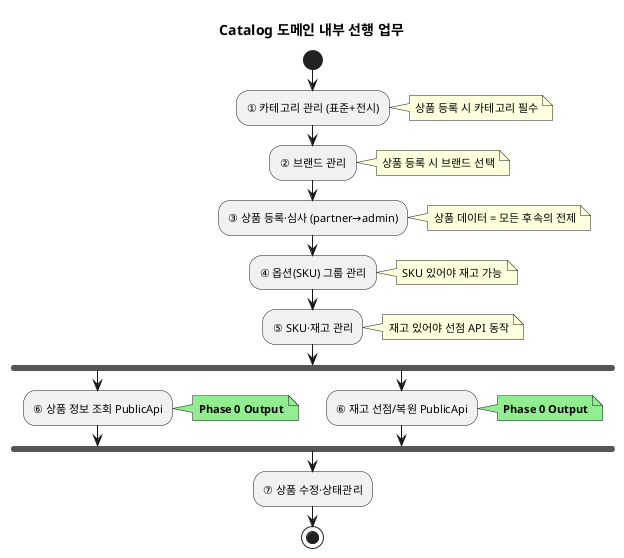
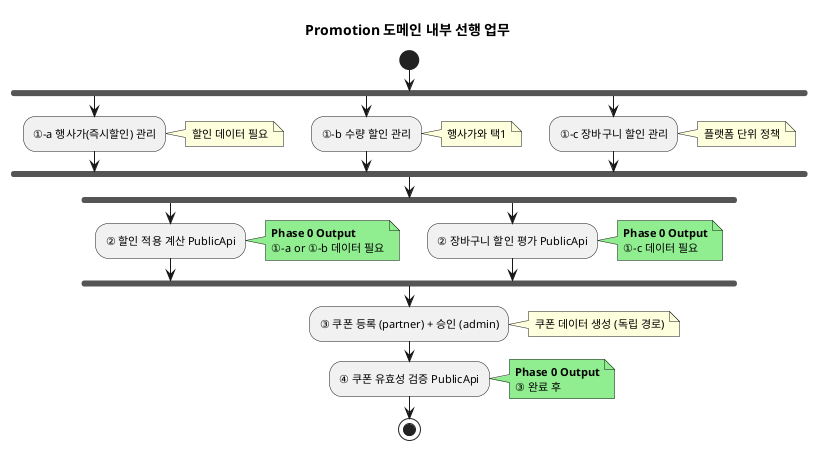
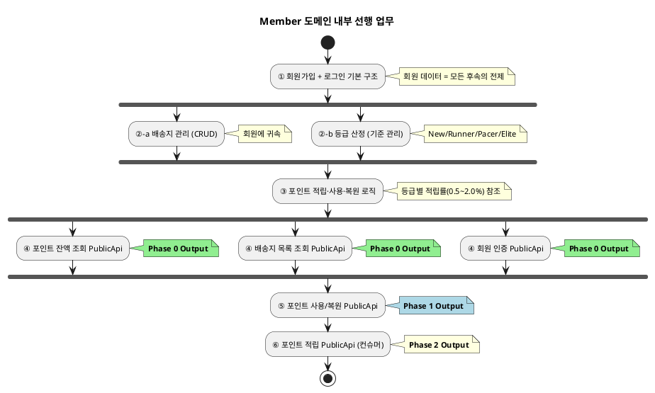
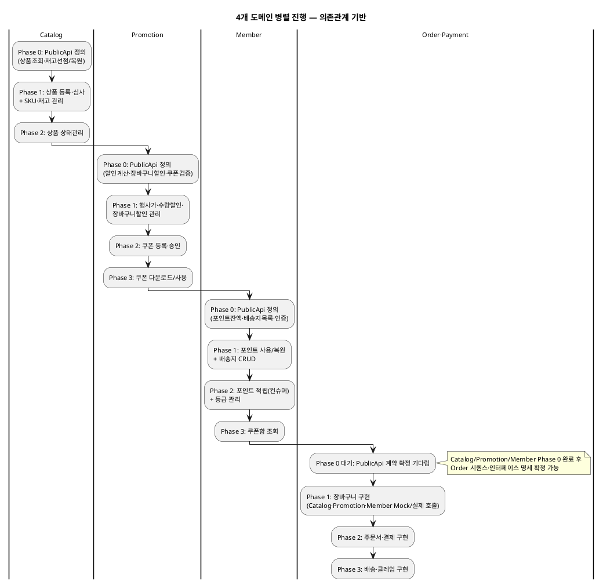
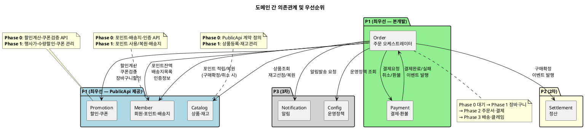
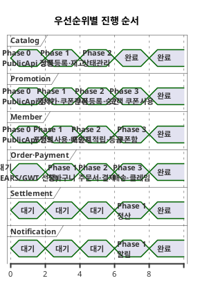

# 도메인 간 우선 업무 및 의존관계 (1차: Order·Payment 본개발 기준)

| 항목 | 내용 |
|---|---|
| 문서 유형 | 기술참조 (Tasks 공정 — WBS·의존성맵 입력자료) |
| 작성일 | 2026-07-30 |
| 전제 | 1차 본개발 대상: Order·Payment. 연관 도메인(Catalog·Promotion·Member)은 Mock→점진 실구현 |

---

## 1. 문제

Order·Payment 도메인을 본개발하려면 Catalog·Promotion·Member의 **일부 기능이 먼저 정의·구현**되어야 합니다.
4개 도메인이 동시에 진행하되, 서로의 블로킹을 최소화하려면 **우선 업무와 의존 관계**가 명확해야 합니다.

---

## 2. Order가 호출하는 Catalog PublicApi

| Order EARS | Catalog에서 필요한 것 | Catalog 소분류 | 우선순위 |
|---|---|---|---|
| REQ-ORD-059 (담기 시 유효성 검증) | 상품 판매상태·재고·옵션 확인 | 재고 존재 여부 API + 상품 상세 조회 | **P1** |
| REQ-ORD-064 (유효성 재검사) | 품절 SKU 확인 | 재고 존재 여부 API | **P1** |
| REQ-ORD-057 (재고 선점) | 재고 차감 | 재고 자동 차감/복구(컨슈머) | **P1** |
| REQ-ORD-006/058 (취소·실패 시 복원) | 재고 복원 | 재고 자동 차감/복구(컨슈머) | **P1** |
| REQ-ORD-035 (반품 재고 복구) | 재고 수동 복구 | 재고 자동 차감/복구(컨슈머) | P2 |
| REQ-ORD-060 (장바구니 조회) | 상품명·이미지·옵션명 조회 | 상품 상세 조회(고객) | **P1** |

---

## 3. Order가 호출하는 Promotion PublicApi

| Order EARS | Promotion에서 필요한 것 | Promotion 소분류 | 우선순위 |
|---|---|---|---|
| REQ-ORD-059 (담기 시 행사가격) | 상품별 행사가 조회 (즉시할인 or 수량구간 → 택1) | 할인 적용 계산(컨슈머) | **P1** |
| REQ-ORD-064 (행사가격 변경 재계산) | 행사가 유효 여부 확인 | 할인 적용 계산(컨슈머) | **P1** |
| REQ-ORD-103 (장바구니 할인 검증) | 장바구니 할인 조건 평가 (플랫폼 단위) | 장바구니 할인 관리 + 할인 적용 계산 | **P1** |
| 장바구니 쿠폰 적용 | 쿠폰 유효성 검증 + 할인금액 계산 | 쿠폰 사용(고객) | **P1** |
| REQ-ORD-073 (포인트 사용 시 재계산) | 할인 적용 후 결제금액 계산 | 할인 적용 계산(컨슈머) | **P1** |
| REQ-ORD-106 (수량구간 넛지) | 수량구간 조건 조회 | 수량 할인 관리 | P3 |

---

## 3.5 Order가 호출하는 Member PublicApi

| Order EARS | Member에서 필요한 것 | Member 소분류 | 우선순위 |
|---|---|---|---|
| REQ-ORD-073 (포인트 사용) | 보유 포인트 잔액 조회 | 포인트 조회(고객) | **P1** |
| REQ-ORD-074 (포인트 초과 검증) | 보유 포인트 잔액 확인 | 포인트 적립·사용·복원·소멸 | **P1** |
| REQ-ORD-072 (배송지 선택) | 등록된 배송지 목록 조회 | 배송지 관리(고객) | **P1** |
| REQ-ORD-060 (장바구니 - 쿠폰/포인트 안내) | 사용 가능 포인트 + 쿠폰 수 조회 | 포인트 조회 + 쿠폰 조회 | **P1** |
| REQ-ORD-015 (본인 주문만 반환) | 회원 인증 정보 (memberId) | 로그인 | **P1** |
| REQ-ORD-066 (비회원→회원 병합) | 로그인 완료 이벤트 수신 | 로그인 | P2 |
| 구매확정 → 포인트 적립 | 포인트 적립 요청 (등급별 적립률) | 포인트 적립(컨슈머) | P2 |
| 취소/환불 → 포인트 복원 | 포인트 복원 요청 | 포인트 적립·사용·복원·소멸 | P2 |
| 주문서 진입 시 등급 확인 | 회원 등급 조회 (등급별 혜택 표시) | 등급 산정 | P3 |

---

## 4. Catalog 도메인 — 우선 진행 업무

| Phase | 업무 | 산출물 | 이유 | 블로킹 대상 |
|---|---|---|---|---|
| **0 (최우선)** | 상품 정보 조회 PublicApi 정의 | EARS + 인터페이스 명세 | Order 장바구니의 기본 데이터 | Order 시퀀스·인터페이스 명세 |
| **0 (최우선)** | 재고 선점/복원 PublicApi 정의 | EARS + 인터페이스 명세 | Order 결제 시 반드시 필요 | Order 결제 플로우 전체 |
| **1** | 상품 등록·심사 (partner→admin) | 전체 Bolt | 상품 데이터 없으면 주문 불가 | Order 통합테스트 |
| **1** | SKU·재고 관리 (partner) | 전체 Bolt | 재고 선점이 동작하려면 재고 데이터 필요 | Order 통합테스트 |
| **2** | 상품 수정·상태관리 | 전체 Bolt | 판매중지/품절 상태 전환 → 장바구니 검증 | Order 경계값 테스트 |

---

## 5. Promotion 도메인 — 우선 진행 업무

| Phase | 업무 | 산출물 | 이유 | 블로킹 대상 |
|---|---|---|---|---|
| **0 (최우선)** | 할인 적용 계산 PublicApi 정의 | EARS + 인터페이스 명세 | 장바구니·주문서 가격 계산의 핵심 | Order 인터페이스 명세 응답 구조 |
| **0 (최우선)** | 장바구니 할인 조건 평가 PublicApi 정의 | EARS + 인터페이스 명세 | 플랫폼 단위 할인 적용 여부 판단 | Order 결제금액 산출 |
| **0 (최우선)** | 쿠폰 유효성 검증 PublicApi 정의 | EARS + 인터페이스 명세 | 상품 쿠폰·장바구니 쿠폰 적용 시 필수 | Order 쿠폰 적용 API |
| **1** | 행사가(즉시할인) 관리 (admin) | 전체 Bolt | 할인 계산 API의 입력 데이터 | Order 통합테스트 |
| **1** | 수량 할인 관리 (admin) | 전체 Bolt | 택1 대상 데이터 | Order 통합테스트 |
| **1** | 장바구니 할인 관리 (admin) | 전체 Bolt | 장바구니 할인 평가의 입력 데이터 | Order 통합테스트 |
| **2** | 쿠폰 등록 (partner) + 승인 (admin) | 전체 Bolt | 쿠폰 적용 API의 입력 데이터 | Order 쿠폰 적용 통합테스트 |
| **3** | 쿠폰 다운로드/사용 (고객) | 전체 Bolt | 주문서 쿠폰 선택 UX | Order 고객 E2E |

---

## 5.5 Member 도메인 — 우선 진행 업무

| Phase | 업무 | 산출물 | 이유 | 블로킹 대상 |
|---|---|---|---|---|
| **0 (최우선)** | 포인트 잔액 조회 PublicApi 정의 | EARS + 인터페이스 명세 | Order 주문서에서 "사용 가능 포인트" 표시 | Order 주문서 인터페이스 명세 |
| **0 (최우선)** | 배송지 목록 조회 PublicApi 정의 | EARS + 인터페이스 명세 | Order 주문서에서 배송지 선택 | Order 주문서 인터페이스 명세 |
| **0 (최우선)** | 회원 인증 (로그인) 기본 구조 | EARS + 인터페이스 명세 | 모든 인증 필수 API의 전제 | Order·Payment 전체 |
| **1** | 포인트 사용/복원 PublicApi 정의 | EARS + 인터페이스 명세 | 결제 시 포인트 차감, 취소 시 복원 | Order 결제 플로우 |
| **1** | 배송지 CRUD (고객) | 전체 Bolt | 주문서에서 배송지 신규 추가 | Order 통합테스트 |
| **2** | 포인트 적립 (컨슈머) | 전체 Bolt | 구매확정 이벤트 수신 → 등급별 적립 | Order 구매확정 통합테스트 |
| **2** | 등급 관리 | 전체 Bolt | 등급별 적립률·혜택 표시 | 부가 기능 (블로킹 아님) |
| **3** | 쿠폰함 조회 (고객) | 전체 Bolt | 주문서 쿠폰 선택 UX | Order 고객 E2E |

---

## 5.9 도메인 내부 선행 관계 (Phase 0을 제공하기 위한 도메인 내 순서)

### Catalog 내부 선행 관계

| 순서 | 업무 | 선행 조건 | 이유 | Mock 대체 |
|---|---|---|---|---|
| ① | 카테고리 관리 (표준+전시) | 없음 (최초) | 상품 등록 시 카테고리 필수 선택 | ✅ Mock (고정 카테고리 JSON) |
| ② | 브랜드 관리 | 없음 | 상품 등록 시 브랜드 선택 | ✅ Mock (고정 브랜드 JSON) |
| ③ | 상품 등록·심사 | ①카테고리 + ②브랜드 | 상품 데이터가 모든 후속 기능의 전제 | ✅ Mock (고정 상품 데이터) |
| ④ | 옵션(SKU) 그룹 관리 | ③상품 등록 | SKU 생성은 상품 등록의 하위 단계 | ✅ Mock (고정 SKU) |
| ⑤ | SKU·재고 관리 | ④SKU 존재 | 재고 수량 설정은 SKU가 있어야 가능 | ✅ Mock (재고 항상 있음) |
| **⑥** | **상품 정보 조회 PublicApi** | ③+④+⑤ 완료 | ← **Phase 0 Output** | ✅ Mock (고정 상품정보 반환) |
| **⑥** | **재고 선점/복원 PublicApi** | ⑤ 완료 | ← **Phase 0 Output** | ✅ Mock (항상 성공) |
| ⑦ | 상품 수정·상태관리 | ③ 존재 | 판매중지/품절 전환 | ✅ Mock (고정 상태) |

> **결론**: Catalog는 **Phase 0 전체를 Mock으로 대체 가능**. 고정 상품·SKU·재고 데이터만 있으면 Order가 동작함. 다만 **카테고리 체계 설계**(표준 vs 전시 구조, 계층 깊이)는 정책 결정이 필요하지만 Order 블로킹이 아니므로 후순위 가능.

---

### Promotion 내부 선행 관계

| 순서 | 업무 | 선행 조건 | 이유 | Mock 대체 |
|---|---|---|---|---|
| ①-a | 행사가(즉시할인) 관리 | 없음 (Catalog 상품 ID만 참조) | 할인 계산의 입력 데이터 | ✅ Mock (고정 할인율 반환) |
| ①-b | 수량 할인 관리 | 없음 | 행사가와 택1 — 둘 중 하나 데이터 필요 | ✅ Mock (고정 구간 반환) |
| ①-c | 장바구니 할인 관리 | 없음 | 플랫폼 단위 할인 정책 등록 | ⚠️ **정책 결정 필요** — 조건금액·할인금액 수치 확정 |
| **②** | **할인 적용 계산 PublicApi** | ①-a or ①-b 데이터 존재 | ← **Phase 0 Output** | ✅ Mock (고정 할인금액 반환) |
| **②** | **장바구니 할인 조건 평가 PublicApi** | ①-c 데이터 존재 | ← **Phase 0 Output** | ✅ Mock (조건 충족 시 고정 할인) |
| ③ | 쿠폰 등록 + 승인 | 없음 (독립 경로) | 쿠폰 데이터 생성 | ✅ Mock (고정 쿠폰 데이터) |
| **④** | **쿠폰 유효성 검증 PublicApi** | ③ 완료 | ← **Phase 0 Output** (쿠폰 경로) | ✅ Mock (항상 유효 반환) |

> **핵심**: 할인계산 API는 행사가 or 수량할인 **1건만 등록하면 즉시 제공 가능** — 가장 빠른 경로. 쿠폰검증은 등록→승인 2단계를 거쳐야 해서 상대적으로 느림.
>
> **정책 결정 필요 사항**:
> - ①-c 장바구니 할인: "N만원 이상 구매 시 M원 할인" — N, M 수치 확정 필요
> - 행사가 ↔ 수량구간 택1 중복등록 방지 규칙 — 이미 확정 (프로모션-할인유형-적용순서.md)
> - 장바구니 할인 = 플랫폼 단위 (벤더별 아님) — 이미 확정

---

### Member 내부 선행 관계

| 순서 | 업무 | 선행 조건 | 이유 | Mock 대체 |
|---|---|---|---|---|
| ① | 회원가입 + 로그인 기본 구조 | 없음 (최초) | 회원 데이터 = 모든 후속의 전제 | ✅ Mock (Bearer {userId} — 이미 확정) |
| ②-a | 배송지 관리 (CRUD) | ① 회원 존재 | 배송지는 회원에 귀속 | ✅ Mock (고정 배송지 목록 반환) |
| ②-b | 등급 산정 (기준 관리) | ① 회원 존재 | 등급 체계 정의 필요 | ⚠️ **정책 결정 필요** — 등급 기준(구매금액·활동지수) 수치 확정 |
| ③ | 포인트 적립·사용·복원 로직 | ②-b 등급 (적립률 참조) | 등급별 적립률이 정해져야 포인트 로직 구현 가능 | ⚠️ **정책 결정 필요** — 등급별 적립률(0.5~2.0%) 확정 |
| **④** | **포인트 잔액 조회 PublicApi** | ③ 존재 | ← **Phase 0 Output** | ✅ Mock (고정 잔액 반환, 예: 10,000P) |
| **④** | **배송지 목록 조회 PublicApi** | ②-a 존재 | ← **Phase 0 Output** | ✅ Mock (고정 배송지 2건 반환) |
| **④** | **회원 인증 PublicApi** | ① 존재 | ← **Phase 0 Output** | ✅ Mock (Bearer {userId} 이미 적용) |
| **⑤** | **포인트 사용/복원 PublicApi** | ③ 존재 | ← Phase 1 Output (결제 시) | ✅ Mock (항상 성공, 잔액 차감 로그만) |
| **⑥** | **포인트 적립 PublicApi** | ③ + ②-b | ← Phase 2 Output (구매확정 시) | ✅ Mock (항상 성공, 적립 로그만) |

> **결론**: Member도 **Phase 0 전체를 Mock으로 대체 가능** (고정 포인트·배송지·인증). 단, **정책 결정이 필요한 2건**:
> - ②-b 등급 기준: 4단계(New/Runner/Pacer/Elite) 승급 조건 수치 (구매금액 기준선)
> - ③ 적립률: 등급별 0.5% / 1.0% / 1.5% / 2.0% — 수치 확정 필요
>
> 이 정책이 확정되지 않아도 **Mock에서는 고정값**(예: 전원 1% 적립)으로 Order 개발 진행 가능.

---

### 통합 요약

| 도메인 | 최초 선행 (가장 먼저) | Phase 0 전제 | Mock 대체 | 정책 결정 필요 사항 |
|---|---|---|---|---|
| **Catalog** | 카테고리→브랜드→상품→SKU→재고 | 5단계 순차 | ✅ **전체 Mock 가능** (고정 상품·재고) | 카테고리 체계 설계 (Order 블로킹 아님) |
| **Promotion** | 행사가 or 수량할인 1건 등록 | 1단계면 즉시 | ✅ **전체 Mock 가능** (고정 할인금액) | 장바구니 할인 조건 수치 (N만원/M원) |
| **Member** | 회원가입/로그인→배송지→등급→포인트 | 4단계 순차 | ✅ **전체 Mock 가능** (고정 포인트·배송지) | 등급 기준 수치 + 등급별 적립률 |

> **핵심 결론**: 3개 도메인 모두 **Phase 0 PublicApi를 Mock으로 즉시 제공 가능** — Order는 블로킹 없이 개발 진행 가능.
> 정책 결정 3건(장바구니 할인 수치·등급 기준·적립률)은 Order 개발과 **병렬**로 확정하면 되며, 확정 전까지는 Mock 고정값으로 대체.

---

## 6. 4개 도메인 병렬 진행 타임라인

### 도메인 간 의존관계 맵 (화살표 = "A가 B를 호출")

### 우선순위별 진행 순서 (시간축)

---

## 7. Phase 0 산출물 — PublicApi 계약 정의서

Phase 0에서 각 도메인이 내놓아야 할 최소 산출물:

### Catalog PublicApi (Order가 소비)

| API | Method | 용도 |
|---|---|---|
| `/api/internal/catalog/products/{productId}/validity` | GET | 판매상태·옵션 유효성 확인 |
| `/api/internal/catalog/products/{productId}` | GET | 상품명·이미지·옵션명·정상가 조회 |
| `/api/internal/catalog/stocks/reserve` | POST | 재고 선점 (skuId, qty) |
| `/api/internal/catalog/stocks/release` | POST | 재고 복원 (skuId, qty) |
| `/api/internal/catalog/skus/{skuId}/stock` | GET | SKU별 재고 수량 확인 |

### Promotion PublicApi (Order가 소비)

| API | Method | 용도 |
|---|---|---|
| `/api/internal/promotion/products/{productId}/discount` | GET | 상품별 적용 할인 계산 (행사가 or 수량구간 택1 결과) |
| `/api/internal/promotion/cart-discount/evaluate` | POST | 장바구니 할인 조건 평가 (주문 총액 기준) |
| `/api/internal/promotion/coupons/{couponId}/validate` | POST | 쿠폰 유효성 검증 + 할인금액 계산 |
| `/api/internal/promotion/coupons/available` | GET | 사용 가능 쿠폰 목록 (memberId + productIds) |

### Member PublicApi (Order가 소비)

| API | Method | 용도 |
|---|---|---|
| `/api/internal/member/members/{memberId}/points/balance` | GET | 포인트 잔액 조회 |
| `/api/internal/member/members/{memberId}/points/use` | POST | 포인트 사용 (주문 시 차감) |
| `/api/internal/member/members/{memberId}/points/restore` | POST | 포인트 복원 (취소/환불 시) |
| `/api/internal/member/members/{memberId}/points/earn` | POST | 포인트 적립 (구매확정 시) |
| `/api/internal/member/members/{memberId}/addresses` | GET | 등록된 배송지 목록 조회 |
| `/api/internal/member/members/{memberId}/grade` | GET | 회원 등급 조회 (적립률·혜택) |

---

## 8. Mock 전략 (Phase 0 계약 확정 전)

Phase 0 PublicApi 계약이 확정되기 전에도 Order는 작업을 시작할 수 있습니다:

| 단계 | Order 전략 | 조건 |
|---|---|---|
| Phase 0 확정 전 | **고정값 Mock** — Catalog 항상 재고 있음, Promotion 할인 0원 | EARS·GWT 작성 가능, 코드 골격 구현 가능 |
| Phase 0 확정 후 | **계약 기반 Mock** — PublicApi 응답 구조에 맞춘 Mock JSON | 시퀀스·인터페이스 명세 확정, 본격 구현 |
| Catalog/Promotion Phase 1 완료 후 | **실제 호출** — Mock 제거, 실제 PublicApi 연동 | 통합테스트 가능 |

---

## 9. 협업 포인트 (3개 도메인 담당자 간)

| 시점 | 협업 내용 | 참여자 |
|---|---|---|
| **Phase 0 시작 시** | PublicApi 계약 초안 리뷰 — Order가 필요한 필드·에러코드 요구 전달 | Order TL + Catalog 담당 + Promotion 담당 + Member 담당 |
| **Phase 0 확정 시** | 계약 Freeze — 이후 변경은 변경 영향 분석(5.4) 절차 적용 | 전원 |
| **Phase 1 중** | Mock→실제 전환 테스트 — Order가 실제 API 호출 시 응답 정합성 확인 | Order 개발자 + 해당 도메인 개발자 |
| **통합테스트 전** | E2E 시나리오 합의 — 장바구니→결제 전체 흐름에서 4개 도메인 동시 동작 확인 | QA + 전원 |

---

## 10. 요약

| 핵심 원칙 | 설명 |
|---|---|
| **Phase 0(PublicApi 계약)가 크리티컬 패스** | 이것 없이는 Order 시퀀스·인터페이스 명세 확정 불가 |
| **계약 정의 = EARS + 인터페이스 명세** | "왜 필요한가"(EARS)와 "뭘 주고받는가"(API 스펙) 동시 정의 |
| **Mock으로 블로킹 해소** | 계약 확정 후 Mock JSON으로 Order 구현 즉시 시작, 실제 연동은 Phase 1 이후 |
| **4개 도메인 동시 진행** | 각자 Phase 0을 먼저 끝내고, Phase 1부터는 독립적으로 병렬 진행 |

---

## 변경 이력

| 버전 | 일자 | 변경 내용 |
|---|---|---|
| v1.0 | 2026-07-30 | 초판 — Order 의존성 기반 Catalog·Promotion 우선 업무 도출 |
| v1.1 | 2026-07-30 | Member 도메인 추가 — 포인트·배송지·인증 의존관계 및 우선 업무 반영, 4개 도메인 병렬 구조로 확장 |
