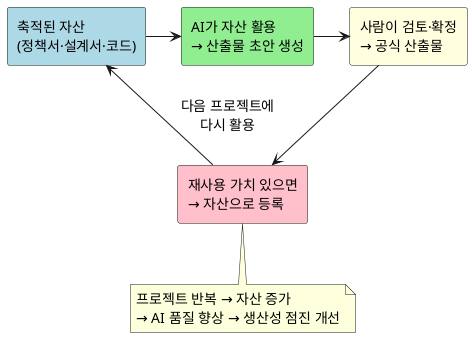
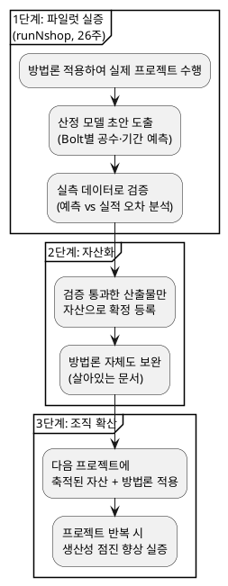

# AI 활용 개발 공정 지침서 — 사업 본부장 보고

**보고 시간**: 10~12분
**원본**: `AI활용_개발공정_지침서_v2.2`
**일자**: 2026-07-30

---

## 1. 문제 — 왜 기존 방식이 안 되는가

| 문제 | 영향 |
|---|---|
| 요구사항 변경 시 산출물 유지비용 폭증 | 문서 재작업에 개발 시간의 30~40% 소모 |
| 핵심 인력 의존도 높음 | 1명 이탈 시 해당 도메인 전체 지연 |
| AI 협업 구조 부재 | AI 도구를 도입해도 "사람이 다 쓰는" 구조 — 생산성 개선 제한적 |
| 프로젝트 종료 후 지식 소멸 | 다음 프로젝트에서 처음부터 반복 |

> **핵심**: AI를 "도구"로만 쓰면 효과가 제한적.
> AI가 **조직의 자산을 이해하고 산출물을 직접 생성**하는 구조가 필요.

---

## 2. 해결 방향 — AI 협업 방법론

**한 줄 요약**: AI가 축적된 자산을 활용해 산출물 초안을 생성하고, 사람은 검토·의사결정에 집중

| 기존 | AI 활용 방법론 |
|---|---|
| 사람이 문서 작성 → AI가 보조 | **AI가 초안 생성** → 사람이 검토·확정 |
| 프로젝트 끝나면 지식 소멸 | 산출물 → **자산으로 축적** → 다음 AI 입력 |
| 인력 교체 시 다시 처음부터 | 자산이 남아 있으므로 **신규 인력도 AI+자산으로 즉시 생산** |

---

## 3. 핵심 — 구조와 효과

### 작동 원리: 자산 선순환

### 7개 공정 · 40종 산출물

**7개 공정**: Proposal → Spec → Design → Tasks → Code → 통합테스트 → 안정화
Proposal~Tasks는 산출물 중심(AI가 문서를 생성), Code~안정화는 활동 중심(AI가 실행·검증에 참여)
**40종 표준 산출물**: 공정마다 무엇을 만들지 정의 → AI가 이해하고 생성 가능

### 기대 효과

| 항목 | 기존 방식 | AI 활용 | 개선 효과 |
|---|---|---|---|
| **산출물 작성** | 사람이 직접 | AI 초안 + 사람 검토 | **50~70% 시간 단축** |
| **인력 의존** | 핵심인력 부재 → 전체 지연 | 자산 기반 → 누구든 AI와 작업 | **인력 리스크 해소** |
| **품질 검증** | 수동 리뷰만 | AI 자동검증 + 사람 판단 | **반복 검증 비용 절감** |
| **지식 축적** | 종료 후 소멸 | 자산으로 영구 축적 | **반복 시 점진 향상** |
| **비용 (목표)** | 기준 대비 | AI 협업 적용 | **30% 절감** |

---

## 4. 파일럿 검증 — 적용 계획과 성공 기준

### 적용 계획

| 항목 | 내용 |
|---|---|
| **적용 프로젝트** | runNshop (B2C 커머스, 12개 도메인) |
| **총 기간** | 26주 |
| **인력** | 4개 파트, 16명 (개발 14명) |
| **작업 단위** | 72개 Bolt (유스케이스 단위, 각 2일) |

| 단계 | 기간 | 비고 |
|---|---|---|
| Proposal~Design (구조 확정) | 5주 | 1회성 |
| **Bolt 반복 (핵심 구현)** | **10주** | 주당 8~10개 병렬 처리 |
| 버퍼 | 3주 | 리스크 대응 |
| 통합테스트 + 안정화 | 8주 | Go/No-Go 게이트 포함 |

### 성공 기준

**프로젝트 성공** — 만든 제품이 괜찮은가 (오픈 판단)

| 조건 | 판정 |
|---|---|
| Critical 0건 + Major 0건 | **Go** |
| Critical 0건 + Major ≤3건 (우회방안 확보) | **조건부 Go** |
| Critical ≥1건 | **No-Go** |

**방법론 성공** — 이 방식을 계속 쓸 만한가 (확산 판단)

| 판단 기준 | 측정 방법 | 목표 |
|---|---|---|
| **생산성** | 동일 규모 기존 프로젝트 대비 비용 비교 | 30% 절감 |
| **자산 재활용률** | 40종 산출물 중 자기완결성 검증 통과 비율 | 80% 이상 |
| **인력 의존도** | 핵심 인력 교체 후에도 자산+AI로 작업 가능 여부 | 정성 확인 |
| **산정 정확도** | Bolt별 예측 공수 vs 실측 공수 오차 | ±30% 이내 |
| **반복 시 개선** | 2번째 도메인 적용 시 1번째 대비 소요 감소 | 20% 이상 |

> 프로젝트 성공 + 방법론 성공 기준을 모두 충족하면 → 5번(조직 확산)으로 진행

---

## 5. 조직 확산 — 성공 후 로드맵

| 단계 | 목표 | 성공 지표 |
|---|---|---|
| **파일럿** | runNshop 26주 내 Go-Live | Critical 0건, Major ≤3건 |
| **자산화** | 40종 산출물 자기완결성 검증 | 원본 없이 재구성 가능한 수준 |
| **확산** | 다음 프로젝트 적용 시 효율 측정 | 동일 규모 대비 비용 30% 절감 |

*상세 규칙·RACI·산출물 40종 전체 목록은 원본(`AI활용_개발공정_지침서_v2.2`) 참조*
