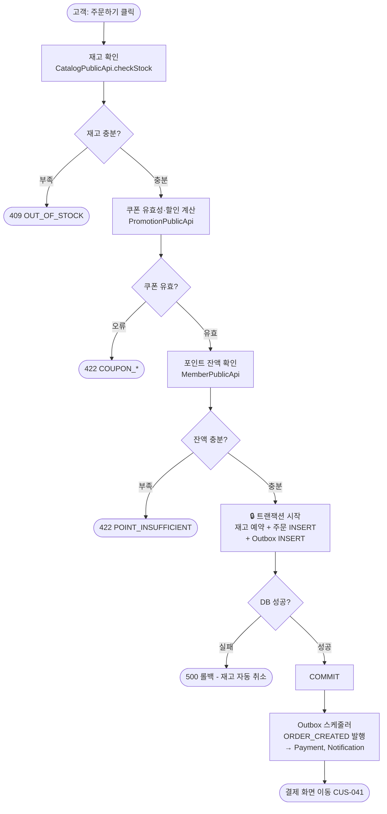

# ④ 업무흐름 정의서 — Harness 샘플

> **샘플 도메인**: Order / **프로세스**: BPM-ORD-001 주문 생성 플로우

---

## 기본 섹션

```
프로세스 ID    : BPM-ORD-001
프로세스명     : 주문 생성 (장바구니 → 주문서 → 결제 요청)
도메인         : Order
시작 이벤트    : 고객이 장바구니에서 "주문하기" 버튼 클릭
종료 조건      : ORDER_CREATED 이벤트 발행 완료 (결제 화면 이동)
참여자         : 고객, OrderSystem, CatalogSystem, PromotionSystem, PaymentSystem

[텍스트 시나리오]
Step 1. 고객: 장바구니에서 상품 선택 후 "주문하기" 클릭
Step 2. 시스템: 선택 상품 재고 확인 (CatalogPublicApi.checkStock)
Step 3. 시스템: 쿠폰 유효성 검증 + 할인 금액 계산 (PromotionPublicApi)
Step 4. 시스템: 포인트 잔액 확인 (MemberPublicApi.checkPointBalance)
Step 5. 시스템: 재고 예약 + 주문 생성 + Outbox 이벤트 저장 [트랜잭션]
Step 6. 시스템: ORDER_CREATED 이벤트 발행 → Payment, Notification 비동기 처리
Step 7. 고객: 결제 화면(CUS-041)으로 이동

[예외 흐름]
E1. Step 2 재고 부족 → 409 OUT_OF_STOCK, 주문 생성 중단
E2. Step 3 쿠폰 오류 → 422 COUPON_*, 주문 생성 중단
E3. Step 4 포인트 부족 → 422 POINT_INSUFFICIENT, 주문 생성 중단
E4. Step 5 DB 오류 → 트랜잭션 롤백, 재고 예약도 자동 취소
E5. Step 6 이벤트 발행 실패 → Outbox 재시도 스케줄러가 처리
```



---

## AI 보강 섹션

```
[AI-H8] 트랜잭션 경계 정의                   ← Context Harness (시간축)
━━━━━━━━━━━━━━━━━━━━━━━━━━━━━━━━━━━━━━━━
transactions:
  - id: TX-ORD-001
    scope: "Step 5 (재고 예약 ~ Outbox INSERT까지)"
    type: DB_TRANSACTION
    rollback_trigger: "DB 오류, 재고 예약 실패"
    compensation: "재고 예약이 같은 트랜잭션이므로 롤백 시 자동 취소"

[AI-H9] 이벤트 발행·수신 지점                ← Context Harness (시간축)
━━━━━━━━━━━━━━━━━━━━━━━━━━━━━━━━━━━━━━━━
events:
  - step: "Step 5 트랜잭션 COMMIT 후 (Outbox 스케줄러)"
    event_name: ORDER_CREATED
    publish_timing: AFTER_COMMIT
    async: true
    consumer_domain: [Payment, Notification]
    outbox: true

[AI-H10] 동기/비동기 구분                    ← Context Harness (시간축)
━━━━━━━━━━━━━━━━━━━━━━━━━━━━━━━━━━━━━━━━
| Step | 호출 대상 | 동기/비동기 | 실패 시 처리 |
|------|----------|-----------|------------|
| Step 2 | Catalog 재고 확인 | 동기 | 409 반환, 주문 중단 |
| Step 3 | Promotion 쿠폰 계산 | 동기 | 422 반환, 주문 중단 |
| Step 4 | Member 포인트 확인 | 동기 | 422 반환, 주문 중단 |
| Step 5 내부 | Catalog 재고 예약 | 동기 (트랜잭션 내) | 롤백 |
| Step 6 | Payment 결제 요청 | 비동기 (Outbox) | 재시도 3회 → DLQ |
| Step 6 | Notification 발송 | 비동기 (Outbox) | 재시도 3회 → DLQ |

[AI-H11] 타임아웃·배치 트리거                ← Context Harness (시간축)
━━━━━━━━━━━━━━━━━━━━━━━━━━━━━━━━━━━━━━━━
timeouts:
  - condition: "order_status=TEMP 상태 30분 경과"
    action: "CANCELLED_TIMEOUT 전환 + 재고 복원"
    trigger: TempOrderTimeoutBatch
    schedule: "매 5분"

  - condition: "ord_outbox.published=FALSE 5분 경과"
    action: "이벤트 재발행 시도"
    trigger: OutboxPublisherBatch
    schedule: "매 1분"
```
