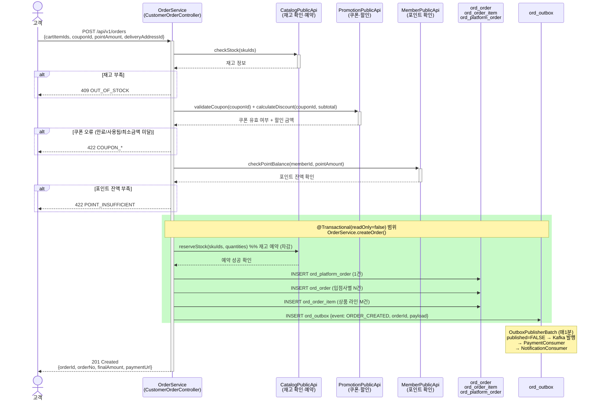

# ⑧-1 Sequence 서브산출물 — Harness 샘플

> **샘플**: SEQ-ORD-001 주문 생성 Sequence

---

## 문서 헤더

```yaml
sequence_id: SEQ-ORD-001
api_id: ORD-001
api_name: 주문 생성
domain: Order
업무흐름_참조: BPM-ORD-001   # ④ 업무흐름 "주문서 → 결제 요청" 플로우 참조
작성일: 2026-07-03
```

---

## [AI-H23] Sequence 다이어그램                ← Context Harness (시간축)

```yaml
transaction_scope: "재고 예약(CatalogPublicApi.reserveStock) ~ ord_outbox INSERT까지"
event_publish_timing: AFTER_COMMIT
involved_domains:
  - Catalog    # 동기: 재고 확인 + 예약
  - Promotion  # 동기: 쿠폰 유효성 + 할인 계산
  - Member     # 동기: 포인트 잔액 확인
  - Payment    # 비동기: ORDER_CREATED 이벤트 수신
  - Notification  # 비동기: ORDER_CREATED 이벤트 수신
```



---

## 보완 설명

| 항목 | 내용 |
|------|------|
| 트랜잭션 타입 | DB_TRANSACTION (@Transactional 단일 DB) |
| 외부 API 호출 위치 | checkStock, validateCoupon, checkPointBalance → 트랜잭션 **전** (DB 잠금 연장 방지) |
| 재고 예약 위치 | reserveStock → 트랜잭션 **내** (주문 INSERT와 원자적 처리) |
| 이벤트 발행 방식 | AFTER_COMMIT — Outbox 스케줄러가 Kafka 발행 |
| 결제 처리 | 이 API 범위 밖 (Payment가 ORDER_CREATED 이벤트 수신 후 처리) |

```yaml
wrong_patterns:
  - "checkStock을 @Transactional 내부에서 호출 (외부 API 장애 시 DB 잠금 연장)"
  - "reserveStock을 @Transactional 외부에서 호출 (주문 롤백 시 재고 예약 복원 불가)"
  - "Outbox INSERT를 @Transactional 외부에서 실행 (주문 성공 + 이벤트 누락 가능)"
  - "ORDER_CREATED를 Kafka에 직접 발행 (트랜잭션 실패 시 이미 발행된 이벤트 취소 불가)"
  - "Payment 결제 처리를 이 API에서 직접 구현 (강결합, 도메인 경계 위반)"
```
