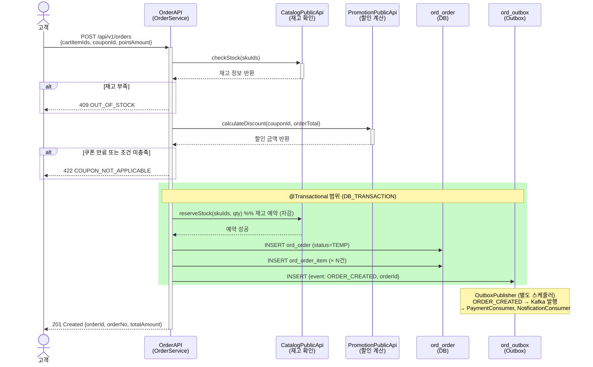

# runNshop Sequence 서브산출물 샘플

- **문서버전**: v1.0
- **작성일**: 2026-07-03
- **목적**: ⑧ API정의서 서브산출물 Sequence 표준양식 작성 예시 (Order 도메인 주문 생성)

---

## 문서 헤더

```yaml
sequence_id: SEQ-ORD-001
api_id: ORD-001
api_name: 주문 생성
domain: Order
업무흐름_참조: BPM-ORD-001   # ④ 업무흐름 "주문서 → 결제 요청" 플로우 참조
작성일: 2026-07-03
```

---

## [AI-H23] Sequence 다이어그램 (API별)        ← Context Harness (시간축)

```yaml
transaction_scope: "재고 차감(CatalogPublicApi) ~ Outbox 이벤트 INSERT 까지"
event_publish_timing: AFTER_COMMIT
involved_domains:
  - Catalog    # 동기: 재고 확인·예약
  - Promotion  # 동기: 쿠폰·포인트 적용 계산
  - Payment    # 비동기: ORDER_CREATED 이벤트 수신
  - Notification  # 비동기: ORDER_CREATED 이벤트 수신
```



### 보완 설명

| 항목 | 내용 |
|------|------|
| 트랜잭션 타입 | DB_TRANSACTION (단일 DB, @Transactional) |
| 재고 예약 위치 | 트랜잭션 **내부** — 주문 INSERT와 원자적 처리 |
| 이벤트 발행 | AFTER_COMMIT — Outbox 스케줄러가 Kafka 발행 |
| 실패 보상 | 트랜잭션 롤백 시 재고 예약도 자동 롤백 |
| 결제 처리 | 이 API 범위 밖 (ORDER_CREATED 이벤트 수신 후 PaymentService 처리) |

```yaml
wrong_patterns:
  - "트랜잭션 시작 전에 reserveStock 호출 (실패 시 재고 예약 롤백 불가)"
  - "OutboxTable INSERT를 트랜잭션 외부에서 실행 (주문 성공 → 이벤트 누락 가능)"
  - "BEFORE_COMMIT 이벤트 발행 (롤백 시 이미 발행된 이벤트 취소 불가)"
  - "PromotionAPI 호출을 트랜잭션 내부에서 실행 (외부 API 장애 시 DB 잠금 연장)"
  - "Payment 로직을 이 API에서 직접 처리 (강결합, 도메인 경계 위반)"
```

---

## 작성 기준 메모

- `rect rgb(200, 250, 200)` 블록 = @Transactional 경계 → 이 블록 안에서만 DB 쓰기
- 동기 외부 API(CatalogAPI, PromotionAPI) 호출은 트랜잭션 **전** 완료 (장애 전파 차단)
- 재고 **확인**은 트랜잭션 외부, 재고 **예약(차감)**은 트랜잭션 내부 → 두 번 호출하는 이유
- Outbox 패턴: 이벤트를 Kafka로 직접 발행하지 않고 DB 테이블에 INSERT → 원자성 보장
