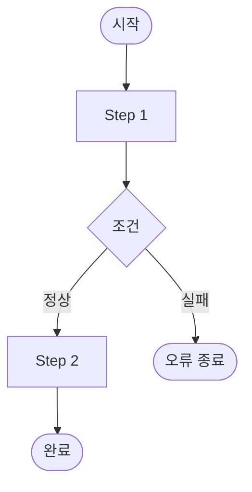

# ④ 업무흐름 정의서 — Harness 표준양식

- **매핑 Harness**: Context Harness (시간축)
- **원천 작성 항목**: 트랜잭션 경계, 이벤트 발행·수신 지점, 동기/비동기 구분, 타임아웃
- **AI-H**: AI-H8 (트랜잭션), AI-H9 (이벤트), AI-H10 (동기/비동기), AI-H11 (타임아웃)
- **참고**: Sequence 서브산출물(⑧-1)의 큰 그림 입력. API별 상세는 Sequence에서 작성.

---

## 기본 섹션 (일반 방법론)

```
프로세스 ID    : BPM-{도메인}-{SEQ}
프로세스명     : 
도메인         : 
시작 이벤트    : 
종료 조건      : 
참여자         : 고객 / 시스템 / 입점사 / 어드민

[텍스트 시나리오]
Step 1. 
Step 2. 
Step 3. 

[다이어그램] (Mermaid flowchart)


[예외 흐름]
E1. ~ 시 → 처리
E2. ~ 시 → 처리
```

---

## AI 보강 섹션

```
[AI-H8] 트랜잭션 경계 정의                   ← Context Harness (시간축)
━━━━━━━━━━━━━━━━━━━━━━━━━━━━━━━━━━━━━━━━
transactions:
  - id: TX-{DOM}-{SEQ}
    scope: "Step {N} ~ Step {M}"
    type: DB_TRANSACTION          # DB_TRANSACTION / SAGA / EVENTUAL
    rollback_trigger: "Step {N} 실패 시"
    compensation: ""              # 실패 보상 로직 (재고 복원, 쿠폰 복원 등)

[AI-H9] 이벤트 발행·수신 지점                ← Context Harness (시간축)
━━━━━━━━━━━━━━━━━━━━━━━━━━━━━━━━━━━━━━━━
events:
  - step: "Step {N} 완료 후"
    event_name: {EVENT_NAME}
    publish_timing: AFTER_COMMIT    # BEFORE_COMMIT / AFTER_COMMIT
    async: true
    consumer_domain: []
    outbox: true                    # Outbox Pattern 적용 여부

[AI-H10] 동기/비동기 구분                    ← Context Harness (시간축)
━━━━━━━━━━━━━━━━━━━━━━━━━━━━━━━━━━━━━━━━
| Step | 호출 대상 | 동기/비동기 | 실패 시 처리 |
|------|----------|-----------|------------|
| Step N | {도메인} {역할} | 동기 | 주문 거부 / 재시도 |
| Step M | {도메인} 알림 | 비동기 | 재시도 3회 → DLQ |

[AI-H11] 타임아웃·배치 트리거                ← Context Harness (시간축)
━━━━━━━━━━━━━━━━━━━━━━━━━━━━━━━━━━━━━━━━
timeouts:
  - condition: "{상태} {시간} 경과"
    action: "{전이 상태} 전환"
    trigger: {BatchName}
    schedule: "매 {N}분"
```

---

## 작성 기준

| 항목 | 기준 |
|------|------|
| 다이어그램 필수 표시 | ① 트랜잭션 경계 ② 이벤트 발행 시점 ③ 동기/비동기 분기 |
| compensation | rollback 시 원상복구 대상 (AI의 보상 코드 생성 근거) |
| outbox | ASYNC_EVENT + outbox: true → AI는 Outbox 테이블 INSERT 코드 생성 |
| publish_timing | AFTER_COMMIT 원칙 (BEFORE_COMMIT은 롤백 시 이벤트 취소 불가) |
| 타임아웃 | 상태가 있는 도메인만 해당 (배치 ID와 실행 주기 명시) |

---

## 하위 문서 역참조 경로

```
BPM-{DOM}-{SEQ}
  └─ 큰 그림 → Sequence 서브산출물 SEQ-{DOM}-{SEQ}에서 API별 상세 작성
  └─ 이벤트  → ③ 도메인정의 AI-H6 통신 계약과 일치해야 함
  └─ 트랜잭션 → Data Contract 서브산출물 DC-{DOM}-{SEQ}의 transaction_annotation과 연계
```
