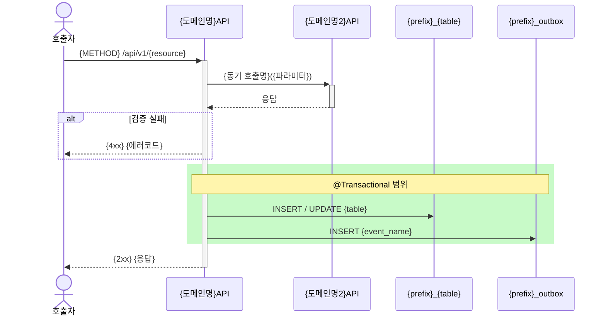

# ⑧-1 Sequence 서브산출물 — Harness 표준양식

- **소속**: ⑧ API 정의서의 서브산출물
- **매핑 Harness**: Context Harness (시간축)
- **AI-H**: AI-H23
- **작성 대상**: 외부 API 동기 호출 + 비동기 이벤트 + @Transactional 경계가 복합된 API
- **참고 입력**: ④ 업무흐름(BPM-*)의 전체 플로우에서 이 API 담당 슬라이스 추출

---

## 문서 헤더

```yaml
sequence_id: SEQ-{DOM}-{SEQ}
api_id: {DOM}-{SEQ}
api_name: 
domain: 
업무흐름_참조: BPM-{DOM}-{SEQ}    # ④ 업무흐름 참조 (큰 그림)
작성일: 
```

---

## [AI-H23] Sequence 다이어그램 (API별)        ← Context Harness (시간축)

```yaml
transaction_scope: "이 API가 커버하는 트랜잭션 범위"
event_publish_timing: AFTER_COMMIT    # BEFORE_COMMIT / AFTER_COMMIT
involved_domains: []                  # 이 API가 호출하는 도메인 목록
```



```yaml
wrong_patterns:
  - "트랜잭션 외부에서 외부 API 동기 호출 (실패 시 보상 불가)"
  - "BEFORE_COMMIT 이벤트 발행 (DB 롤백 시 이벤트 취소 불가)"
  - "Outbox INSERT를 트랜잭션 외부에서 실행"
```

---

## 작성 기준

| 항목 | 기준 |
|------|------|
| rect 블록 | @Transactional 경계를 Mermaid `rect rgb(200,250,200)` 으로 표시 |
| 동기 호출 위치 | 트랜잭션 **전** 완료 (외부 API 장애 시 DB 잠금 연장 방지) |
| Outbox INSERT | 트랜잭션 **내부** (주문 INSERT와 원자적 처리 보장) |
| alt/opt 블록 | 실패 분기 반드시 포함 (AI가 예외 처리 코드 생성 근거) |
| wrong_patterns | 이 API 특유의 실수 패턴 작성 (도메인 레벨 wrong_pattern 보완) |
| 작성 생략 | 단일 테이블 단순 CRUD, 외부 호출 없음 → 생략 가능 |

---

## 하위 문서 역참조 경로

```
SEQ-{DOM}-{SEQ}
  ├─ 상위: {DOM}-{SEQ} (⑧ API정의서)
  └─ 참고 입력: BPM-{DOM}-{SEQ} (④ 업무흐름)
```
