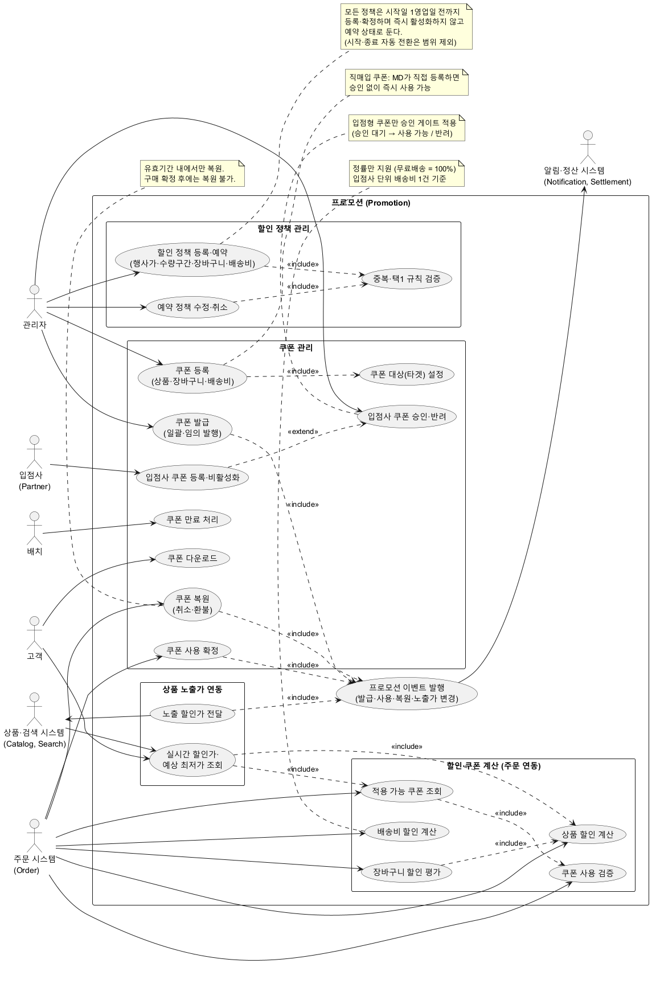
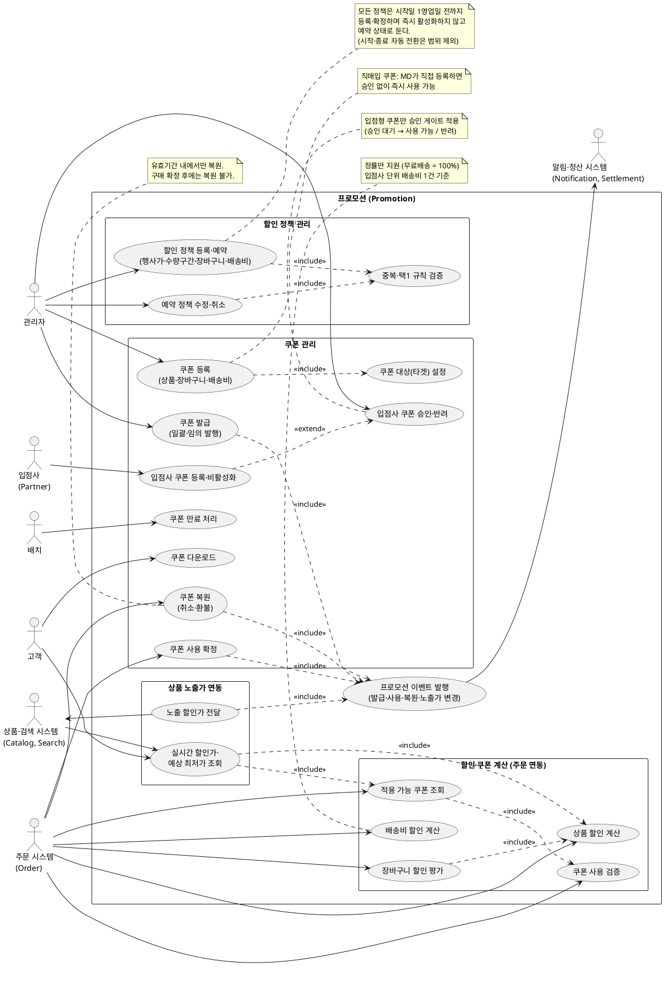

# 유스케이스 다이어그램: 프로모션 (쿠폰·할인 정책)

> 기준: `spec.md` (Clarifications 2026-10-13 반영). 원본 DC 상위 유스케이스에서 아래를 반영·조정했다.
> - 프로모션 운영은 단일 "관리자" 역할 (역할 세분화 없음), 입점사는 자기 쿠폰 등록·비활성화만 수행
> - 배송비 할인·배송비 쿠폰 포함
> - 입점사(partner) 쿠폰·직매입 쿠폰 포함 (도메인정의서 partner 채널 추가, 이슈 #5·#7)
> - 제외: 이벤트·기획전, 포인트 적립·사은품, 정책 시작·종료 자동 전환(FR-013)

> 위 이미지는 아래 PlantUML 소스를 렌더링한 결과이며, 소스를 수정하면 이미지를 다시 생성해야 한다.

## 유스케이스 ↔ spec 매핑

| 유스케이스 | spec 근거 |
|---|---|
| UC01 쿠폰 등록 (직매입 포함) | FR-020, FR-009(배송비 쿠폰) |
| UC02 쿠폰 대상 설정 | FR-020 (REQ-PRM-043) |
| UC03 쿠폰 발급 | FR-021 (REQ-PRM-044) |
| UC04 쿠폰 다운로드 | FR-022 (REQ-PRM-046), US3 |
| UC05 쿠폰 만료 처리 | FR-023 (REQ-PRM-047) |
| UC06 쿠폰 사용 확정 | FR-024 |
| UC07 쿠폰 복원 | FR-024, FR-040 |
| UC08 입점사 쿠폰 등록·비활성화 | FR-026, FR-028 (REQ-PRM-040, 045) |
| UC09 입점사 쿠폰 승인·반려 | FR-027 (REQ-PRM-041, 042) |
| UC10 할인 정책 등록·예약 | FR-010, FR-011, FR-012, FR-009 |
| UC11 예약 정책 수정·취소 | FR-017 (US2 시나리오 5) |
| UC12 중복·택1 규칙 검증 | FR-014, FR-015 |
| UC20 상품 할인 계산 | FR-001, FR-005, FR-006 |
| UC21 장바구니 할인 평가 | FR-002 |
| UC22 배송비 할인 계산 | FR-009 (REQ-PRM-070, 073) |
| UC23 적용 가능 쿠폰 조회 | FR-004 |
| UC24 쿠폰 사용 검증 | FR-003, FR-008 |
| UC30 노출 할인가 전달 | FR-030 |
| UC31 실시간 할인가 조회 | FR-031 |
| UC40 이벤트 발행 | FR-040 |

## 원본(DC) 대비 차이

- 원본의 **이벤트 생성·운영, 이벤트 참여, 기획전 생성·운영** 유스케이스는 부록 A(정책 미확정)이므로 그리지 않았다.
- 원본 DC 본문의 **입점사 쿠폰 유스케이스**(등록·비활성화, 승인·반려)는 DB·D9에 partner 채널이 추가되어 포함했다(UC08, UC09).
- **배송비 할인 계산(UC22)**은 원본 DC에 없고 이번 clarify로 추가됐다.
- **쿠폰 만료 처리(UC05)**는 배치 액터로 분리했다. 정책 시작·종료 자동 전환(원본 REQ-PRM-010-1, 011, 012, 020-1)은 이번 spec에서 제외되어 배치 유스케이스에 없다.
